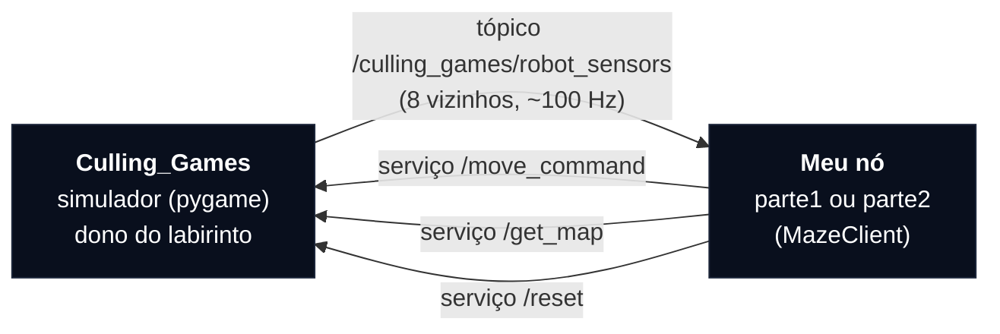
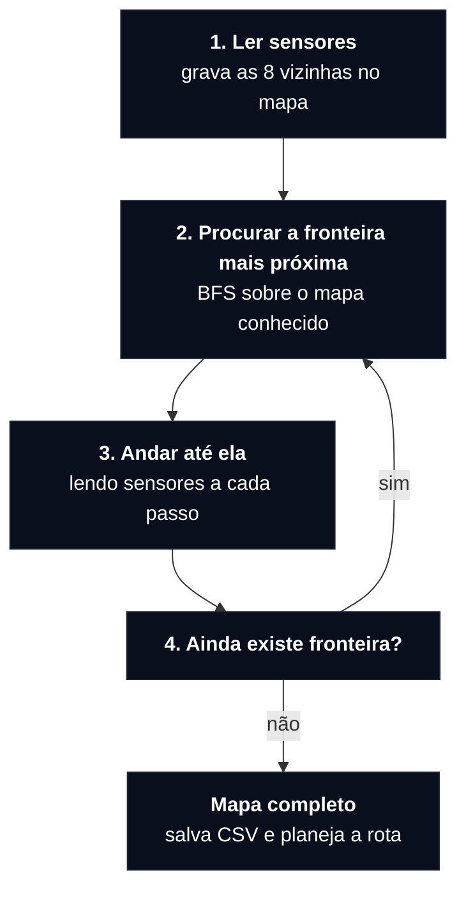

# Resumo para a provinha 

&emsp;Um robô em um labirinto (grid) precisa chegar ao alvo.

- **Parte 1:** com o mapa completo, calcular a rota ótima e executá-la.
- **Parte 2:** sem o mapa, explorar usando só sensores, construir o mapa e provar que ele é suficiente para reproduzir a rota da parte 1.

&emsp;Resultado no mapa 1: rota ótima de **102 movimentos** nas duas partes, **635 passos** de exploração e **0 células divergentes** entre o mapa construído e o real.

## 1. ROS 2 na ponderada

### 1.1. Quem são os nós?

&emsp;Lembrando: um nó é um programa com uma responsabilidade específica. Na ponderada existem dois:

&emsp;Meu nó **não conhece o simulador diretamente**. Ele só combina **nomes** (de tópicos e serviços) e **tipos de mensagem** (pacote `cg_interfaces`). Quem faz os dois se encontrarem é o **DDS**, por descoberta automática, desde que estejam no mesmo `ROS_DOMAIN_ID`.

### 1.2. Por que cada comunicação usa o mecanismo que usa?

| Comunicação | Mecanismo | Por quê? |
| :--- | :--- | :--- |
| Sensores (`/culling_games/robot_sensors`) | **Tópico** | Dado contínuo, publicado o tempo todo, sem precisar de resposta. Qualquer nó interessado pode assinar. |
| Movimento (`/move_command`) | **Serviço** | Pedido curto e rápido, e eu **preciso da resposta**: se deu certo (`success`), onde o robô está (`robot_pos`) e onde está o alvo (`target_pos`). |
| Mapa (`/get_map`) | **Serviço** | Pergunto uma vez, recebo o grid inteiro. |
| Reiniciar (`/reset`) | **Serviço** | Comando pontual, com confirmação. |

&emsp;<b>*E por que não Action?*</b> Action é para tarefas longas, com feedback e possibilidade de cancelamento (ex.: `/navigate_to_pose` do Nav2). No labirinto, cada movimento é **um passo só**, que termina na hora. Quem faz a "tarefa longa" (navegar até o alvo) é o meu código, mandando vários serviços em sequência.

&emsp;Se fosse um robô real com Nav2, o "ir até o alvo" provavelmente seria uma **action**: demora, quero acompanhar o progresso e talvez cancelar.

### 1.3. Mensagens (o "formato" da conversa)

&emsp;Para dois nós conversarem, eles precisam concordar sobre o **formato** das informações. Na ponderada, esses formatos já vinham prontos junto com o simulador.

| Comunicação | O que eu envio | O que eu recebo |
| :--- | :--- | :--- |
| Mover | A direção (cima, baixo, esquerda ou direita) | Se o movimento deu certo, onde o robô está e onde está o alvo |
| Pedir o mapa | Nada, só o pedido | O labirinto inteiro, célula por célula |
| Reiniciar | Qual labirinto carregar | Confirmação de que reiniciou |
| Sensores | — | O que existe nas 8 células em volta do robô |

&emsp;<b>*Por que isso importa?*</b> A resposta do movimento foi essencial para as decisões: saber se o robô **andou ou bateu na parede** é o que permite estimar a posição na parte 2.

### 1.4. QoS (Quality of Service — qualidade de serviço)

&emsp;São regras que dizem **como** as mensagens devem ser entregues. Duas opções importantes:

| Tipo | Ideia | Quando usar |
| :--- | :--- | :--- |
| **Reliable** (confiável) | Garante que toda mensagem chegue, nem que precise reenviar | Quando nenhuma mensagem pode se perder (ex.: um comando importante) |
| **Best effort** (melhor esforço) | Tenta entregar, mas se perder alguma, segue em frente | Quando chegam muitas mensagens e a mais nova é a que importa (ex.: sensores) |

&emsp;Imagine um placar de jogo atualizado várias vezes por segundo. Se uma atualização se perder, não tem problema: logo vem outra mais nova. Não vale a pena esperar a antiga chegar.

&emsp;Na ponderada, os sensores usavam **best effort**, publicados cerca de 100 vezes por segundo.

&emsp;<b>*Qual foi o problema?*</b> As mensagens chegam sem sincronia com o movimento. Logo depois de mandar o robô andar, a leitura que chega pode ainda ser de **antes** do passo. Se eu usasse essa leitura, gravaria no mapa o que o robô via na posição antiga como se fosse a nova.

&emsp;<b>*Decisão:*</b> depois de cada movimento, esperar algumas leituras **novas** antes de confiar nos sensores. Perco um pouco de velocidade, mas ganho um mapa confiável.

### 1.5. Pacotes

&emsp;Existem dois pacotes:

| Pacote | Função |
| :--- | :--- |
| **Simulador** (da professora) | Desenha o labirinto, move o robô, publica os sensores e define o formato das mensagens |
| **Minha solução** | Decide como o robô navega: calcula a rota (parte 1) e explora e mapeia (parte 2) |

&emsp;<b>*Por que separar?*</b>

- Cada pacote tem **uma responsabilidade**, a mesma ideia dos nós.
- O simulador é o mesmo para todos os alunos. Minha solução só **usa** o que ele oferece, sem precisar alterá-lo.
- Eles só precisam concordar sobre os **nomes** das comunicações e o **formato** das mensagens. Por isso eu poderia trocar o simulador por outro (ou por um robô real) sem reescrever toda a lógica.

## 2. Posicionamento

### 2.1. Pose no labirinto

&emsp;Nas aulas, a pose 2D é \(q=(x,y,\theta)\): posição + orientação.

&emsp;No labirinto, a pose se simplifica para **(linha, coluna)**. O robô **não tem orientação (θ)**, porque os comandos `up/down/left/right` são **absolutos**, no referencial do mapa. "Up" sempre diminui a linha, independentemente de para onde o robô "aponta".

&emsp;Compare com um robô diferencial real (TurtleBot): ele só anda para a frente no próprio eixo X, e para ir para a esquerda precisa **girar primeiro** (restrição não holonômica). No labirinto essa restrição não existe: o robô se move lateralmente direto.

> Convenção do grid: (linha, coluna), com "up" = linha − 1. Não é a convenção REP 103 do ROS (X frente, Y esquerda, Z cima).

### 2.2. Posição inicial e final — Parte 1

- **Inicial:** procuro a célula `r` no mapa do `/get_map`. No mapa 1: **(1, 1)**.
- **Final (alvo):** procuro a célula `t`. No mapa 1: **(14, 14)**.
- **Confirmação de chegada:** depois do último movimento, comparo `robot_pos == target_pos` na resposta do `/move_command`.

&emsp;Na parte 1 não existe problema de localização: o mapa já diz onde o robô está. Por isso **não preciso de AMCL** (AMCL serve para estimar a pose num mapa existente quando ela é incerta).

### 2.3. Posição inicial e final — Parte 2 (sem mapa)

&emsp;Sem `/get_map`, o robô **não sabe onde está no labirinto**. A solução foi criar um **referencial próprio**:

1. O ponto de partida vira a origem: **(0, 0)**.
2. A cada movimento **bem-sucedido**, somo o deslocamento: `up` = (−1, 0), `down` = (+1, 0), `left` = (0, −1), `right` = (0, +1).
3. Se o movimento falhar (`success = false`), a posição não muda e a célula vira parede no mapa.

&emsp;Isso é **odometria**: estimar a pose somando os deslocamentos ao longo do tempo.

&emsp;No mapa 1 o alvo foi detectado em **(13, 13)** no referencial do robô. Para levar ao referencial do mapa real, é só uma **translação** pela posição inicial real (1, 1):

\[(13,13)+(1,1)=(14,14)\]

&emsp;Não tem rotação, porque os dois referenciais estão alinhados (mesmo sentido de linhas e colunas). É o caso mais simples de transformação de coordenadas.

&emsp;Esse ajuste só é feito na **verificação**. Para planejar e executar a rota, o referencial do robô basta, porque o caminho é relativo ao ponto de partida.

### 2.4. Por que a odometria aqui não tem deriva?

&emsp;Em robô real, odometria acumula erro (deriva/drift): escorregamento, raio da roda errado, viés do giroscópio. Por isso existe o referencial `map`, que corrige o `odom` usando LiDAR/mapa (AMCL ou SLAM).

&emsp;No labirinto, o movimento é **discreto e determinístico**: ou anda exatamente uma célula ou não anda, e o simulador confirma. Então a odometria é **exata**, e não precisei de correção.

&emsp;<b>*Se fosse um robô real?*</b> A odometria iria derivar e o mapa construído ficaria distorcido. Seria preciso corrigir a pose com os sensores (localização/SLAM, fechamento de loop).

## 3. Mapeamento

### 3.1. Que tipo de mapa eu construí?

&emsp;Um **mapa geométrico do tipo occupancy grid**, com os três estados da aula 4:

| Estado na aula | No meu mapa |
| :--- | :--- |
| Livre | `f` |
| Ocupado | `b` |
| Desconhecido | célula que ainda não está no dicionário (salva como `?` no CSV) |

&emsp;Diferença para o occupancy grid real: lá a ocupação costuma ser **probabilística** (ruído de sensor). Aqui os sensores são perfeitos, então cada célula é certeza: livre ou parede.

&emsp;O mapa é guardado como um **dicionário** `(linha, coluna) → valor`, e não como matriz.

&emsp;<b>*Por quê?*</b> No início eu **não sei o tamanho do labirinto** nem onde estou nele. As coordenadas podem ficar negativas (ex.: parede em (−1, 0), acima do ponto de partida). Com o dicionário, o mapa "cresce" conforme descubro. No final, recorto o retângulo conhecido e salvo em `mapa_construido.csv`.

### 3.2. O que os sensores dão?

&emsp;O conteúdo das **8 células vizinhas** (incluindo diagonais). O robô vê só a vizinhança imediata, nunca o labirinto inteiro.

### 3.3. Estratégia: exploração por fronteira

&emsp;**Fronteira** = célula livre já conhecida que ainda tem algum vizinho (cima/baixo/esquerda/direita) desconhecido. É a "borda" entre o que conheço e o que não conheço.

&emsp;<b>*Por que a fronteira **mais próxima**?*</b> Para andar menos. Ir sempre à fronteira mais perto evita atravessar o labirinto inteiro para explorar um canto e depois voltar.

&emsp;<b>*Quando para?*</b> Quando não sobra nenhuma fronteira. Isso significa que **toda célula alcançável e as paredes em volta dela são conhecidas**.

### 3.4. Relação com SLAM

&emsp;SLAM = construir o mapa **e** estimar a localização ao mesmo tempo. A parte 2 é uma **versão simplificada de SLAM**:

- **Mapeamento:** os sensores preenchem o grid.
- **Localização:** a odometria diz onde estou no meu próprio referencial.

&emsp;O que fica mais fácil que no SLAM real: a odometria não deriva, então não preciso de **fechamento de loop** (reconhecer um lugar já visitado para corrigir o erro acumulado).

## 4. Planejamento

### 4.1. O labirinto como grafo

&emsp;Mesma ideia do mapa topológico, \(G=(V,E)\):

- **Vértices (V):** cada célula livre (`f`, `r`, `t`).
- **Arestas (E):** ligam duas células livres vizinhas na horizontal ou vertical.
- **Peso:** 1 para toda aresta (cada movimento custa um passo).
- **Paredes (`b`)** não entram no grafo.

&emsp;"Rota otimizada" = caminho com **menor número de movimentos**.

### 4.2. Planejamento global vs. local

| | Global | Local / reativo |
| :--- | :--- | :--- |
| O que é | Rota de A até B com o mapa conhecido | Reagir ao que os sensores mostram agora |
| Na ponderada | **Parte 1** inteira; e a rota final da parte 2 | Durante a exploração da **parte 2**: replanejar quando um movimento falha ou a fronteira some |

&emsp;No Nav2 seria: **Planner Server** (global) calcula a rota, **Controller Server** transforma em movimento. No labirinto, "controlar" é só converter a lista de células em comandos `up/down/left/right`.

### 4.3. Algoritmos usados

- **A\*** com distância de **Manhattan** para a rota até o alvo. Manhattan combina com o grid porque o robô só anda na horizontal e vertical (é a distância L1 da aula 4). Como ela **nunca superestima** o custo real (heurística admissível), a rota encontrada é a **ótima**.
 
- **BFS** como comparação: com todas as arestas de peso 1, também acha a ótima, mas explora mais células. Mapa 1: A* expandiu **121** nós; BFS, **129**. Mesmo custo (102).
 
- **BFS** também para achar a **fronteira mais próxima** na exploração. Aqui não existe um "alvo" fixo para guiar uma heurística: qualquer fronteira serve, e a BFS acha a mais perto naturalmente.

> Atenção à diferença: na aula 4, Manhattan aparece em dois papéis. Na **distance transform** ela mede a distância até o **obstáculo** mais próximo. No **A\*** (h(n)) ela estima a distância até o **destino**. Na ponderada usei o segundo.

### 4.4. Executar e confirmar

&emsp;O planejamento entrega uma lista de células (o caminho), mas o simulador só entende comandos de movimento. A execução transforma o plano em ação e confere se deu certo.

1. **Converte o caminho (lista de células) em comandos `up/down/left/right`.**

&emsp;Para cada par de células seguidas, vejo o que mudou: linha aumentou → `down`; diminuiu → `up`; coluna aumentou → `right`; diminuiu → `left`. É o papel do Controller no Nav2, só que bem mais simples.

2. **Manda um `/move_command` por passo.**

&emsp;O robô anda um passo de cada vez e só manda o próximo depois da resposta do anterior. Assim sempre sei onde ele está. No mapa 1 foram 102 comandos.

3. **Se algum falhar, para e reporta.**

&emsp;Com o mapa certo, nenhum passo deveria falhar (`success = false`). Se falhar, o robô não está onde eu acho, e continuar levaria a lugares errados.

4. **No final, confere `robot_pos == target_pos`.**

&emsp;É a prova de que a tarefa foi cumprida, e não só a suposição de que o plano estava certo.

## 5. Decisões

### 5.1. Por que explorar o labirinto **inteiro**, se o alvo apareceu cedo?

&emsp;No mapa 1, o alvo foi detectado cerca de **7 segundos** depois do início, mas a exploração continuou por ~30 s.

&emsp;Se eu parasse ao ver o alvo, teria só uma parte do mapa. A rota calculada sobre um mapa incompleto **pode não ser a ótima**: talvez exista um atalho numa região que ainda não vi.

&emsp;O enunciado pede que o mapa seja **suficiente para reproduzir a rota da parte 1**, que é a ótima. A única forma de **garantir** isso é não deixar fronteira nenhuma.

&emsp;**Trade-off:** custo de exploração alto (635 passos para uma rota de 102), em troca da garantia de rota ótima.

### 5.2. Por que tratar o alvo como **intransponível** durante a exploração?

&emsp;No simulador, **pisar no alvo encerra o jogo** e todos os movimentos seguintes são ignorados. Se o robô passasse pelo alvo explorando, não conseguiria terminar o mapa.

&emsp;Então o alvo é **detectado pelos sensores** (vejo onde ele está), mas o robô **nunca entra nele**. Isso não atrapalha a rota final: o alvo é o fim do caminho, então nenhum caminho ótimo precisa **atravessá-lo**.

### 5.3. Caminhos e decisões descartados

| Descartado | Por quê |
| :--- | :--- |
| **Paredes** (`b`) | Não entram no grafo, então nenhum caminho passa por elas. |
| **Becos sem saída** | O A* não segue por eles na rota final: só levam a caminhos mais longos. Na exploração eles são visitados (preciso conhecê-los para ter certeza), mas a rota final não passa por lá. |
| **Fronteira que deixou de ser fronteira** | Se, no meio do trajeto, os sensores revelam o que tinha em volta da fronteira-alvo, ela deixou de ser fronteira. Abandono o trajeto e escolho outra (não ando à toa). |
| **Trajeto em que um movimento falhou** | Registro a célula como parede e **replanejo** a partir de onde estou. |
| **Usar `/get_map` na parte 2** | Seria "trapacear": a parte 2 é sobre construir o mapa sozinho. O `/get_map` só é chamado **depois** da exploração, para conferir o resultado. |
| **Parar ao achar o alvo** | Não garantiria rota ótima (5.1). |
| **Só BFS na parte 1** | Funciona, mas explora mais. Mantive o BFS só como referência para provar que o A* acha o mesmo custo. |
| **Diagonais** | Os sensores veem diagonais, mas o robô **não anda** na diagonal. Diagonais ajudam a conhecer o mapa, não entram como arestas. |

### 5.4. Como provei que o mapa da parte 2 é suficiente?

1. Salvei o mapa construído em `mapa_construido.csv`, no mesmo formato dos mapas do simulador.
2. Planejei a rota com A* **usando só o mapa construído**.
3. Dei `/reset` e só então consultei o `/get_map` **para comparar**:
   - toda célula mapeada bate com o mapa real (**0 divergências**);
   - o alvo está na posição certa (**True**);
   - o custo é igual ao da parte 1 (**102 = 102**), e a rota é idêntica célula a célula.
4. Executei a rota no simulador e o robô **chegou ao alvo** → `COMPROVADO`.

## 6. Impeditivos

| Impeditivo | Por que acontecia | Solução |
| :--- | :--- | :--- |
| **Pisar no alvo encerra o jogo** | Regra do simulador: depois da vitória, `/move_command` sempre falha | Alvo intransponível durante a exploração (5.2) |
| **Leitura de sensor "atrasada"** | Tópico é assíncrono (100 Hz, best effort): a mensagem que chega pode ser de antes do movimento | Depois de cada passo, esperar **3 mensagens novas** antes de usar os sensores |
| **Reset não é instantâneo** | O serviço só marca o pedido; quem aplica é o loop do pygame | Esperar ~0,5 s depois do `/reset` e ler sensores novos |
| **Não sei o tamanho do mapa nem onde estou** | Parte 2 não pode usar `/get_map` | Referencial próprio com origem (0,0) + mapa em dicionário |
| **Comparar meu mapa com o real** | Referenciais diferentes (o meu começa em (0,0), o real em (1,1)) | Translação pela posição inicial real |
| **`colcon build` falhou** | O gerador de interfaces do ROS (`rosidl`) não aceita **espaço/acento** no caminho ("Área de trabalho") | Mover o workspace para `~/ponderada-m8-labirinto` |
| **Demonstração instantânea** | Sem pausa entre comandos, o robô "teleporta" na tela | Opções `--delay` e `--replay-delay` |

## 7. Ligação com as aulas

1. **Estimar a própria pose** (aula 3) → odometria discreta na parte 2, origem (0,0).

   ↓

2. **Representar o ambiente** (aula 4) → occupancy grid com livre/ocupado/desconhecido.

   ↓

3. **Avaliar obstáculos** → paredes fora do grafo; alvo intransponível na exploração.

   ↓

4. **Planejar o caminho** → A* (Manhattan) sobre o grafo do grid.

   ↓

5. **Executar e acompanhar** → um `/move_command` por passo, conferindo `success` e `robot_pos`.

&emsp;Tudo isso comunicado pelo **ROS 2**: tópico para sensores, serviços para comandos, DDS por baixo.

## Resumo

| Conceito | Na ponderada |
| :--- | :--- |
| Nó | Simulador `Culling_Games` + meu nó (`parte1` / `parte2`) |
| Tópico | `/culling_games/robot_sensors` (8 vizinhos, contínuo) |
| Serviço | `/move_command`, `/get_map`, `/reset` |
| Action | Não usada (cada passo é curto) |
| Mensagens | Pacote `cg_interfaces` |
| QoS | Sensor data (best effort) → esperar leituras novas |
| Pose | (linha, coluna), sem θ; movimentos absolutos |
| Posição inicial / final | `r` e `t` no mapa (parte 1); (0,0) e alvo detectado (parte 2) |
| Odometria | Soma dos movimentos bem-sucedidos; exata, sem deriva |
| Mapa | Occupancy grid (`f`, `b`, desconhecido) em dicionário |
| Exploração | Fronteira mais próxima (BFS) até não sobrar fronteira |
| SLAM | Parte 2 é um SLAM simplificado (sem deriva, sem loop closure) |
| Planejamento | A* com Manhattan (ótimo); BFS como referência |
| Prova da parte 2 | 0 divergências, mesmo custo (102), robô chegou ao alvo |
