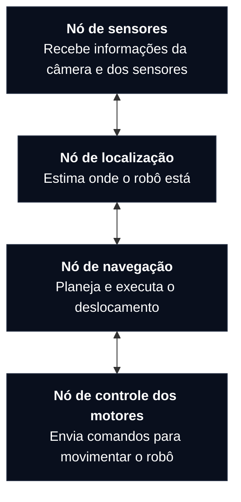

# ROS2 - Robot Operating System (Sistema Operacional para Robôs)

&emsp;Conjunto de ferramentas, bibliotecas e padrões que facilita o desenvolvimento de aplicações robóticas.

&emsp;Não é exatamente um sistema operacional como Ubuntu ou Windows.

&emsp;Permite que partes diferentes do sistema, com responsabilidades distintas, se comuniquem de maneira organizada.

## 1. Como o ROS 2 organiza um sistema robótico?

### 1.1. Nós (Nodes)
&emsp;Programa responsável por uma função específica do robô.

&emsp;Cada nó possui uma responsabilidade. Isso evita que todo o sistema robótico precise estar concentrado em um único programa.

&emsp;Por exemplo, se precisarmos modificar a forma como o robô identifica obstáculos, podemos trabalhar no nó responsável pelos sensores sem necessariamente alterar o nó de controle dos motores.

### 1.2. Como os nós se comunicam?

&emsp;Três principais mecanismos:

- **Topics (tópicos):** comunicação por publicação e assinatura.
- **Services (serviços):** comunicação por solicitação e resposta.
- **Actions (ações):** comunicação para tarefas que podem levar tempo e precisam de acompanhamento.

#### A. Topics
&emsp;Imagine que um sensor mede a distância entre o robô e um obstáculo várias vezes por segundo.

&emsp;Ele publica essas informações em um tópico. Outros nós interessados nessas informações podem se inscrever nesse mesmo tópico e receber os dados.

&emsp;Existem dois papéis:
- **Publisher:** nó que publica informações.
- **Subscriber:** nó que recebe informações de um tópico ao qual está inscrito.

#### B. Services
&emsp;Agora imagine que um nó precisa solicitar uma informação específica a outro nó.

&emsp;Por exemplo: o sistema pergunta ao nó de localização qual é a posição atual do robô.

&emsp;Existem dois papéis:
- **Client:** envia a solicitação.
- **Server:** recebe a solicitação e devolve uma resposta.

&emsp;<b>*Quando usar?*</b> Para operações relativamente rápidas, em que faz sentido solicitar algo e aguardar uma resposta.

#### C. Actions
&emsp;Agora imagine que você solicita ao robô que vá até o banheiro de uma estação.

&emsp;Essa tarefa pode demorar vários segundos ou minutos. Durante esse período, você quer saber se o robô está se movimentando, se encontrou um obstáculo ou se chegou ao destino.

&emsp;Uma action pode ser cancelada enquanto está sendo executada.

&emsp;<b>*Quando usar?*</b> Para tarefas demoradas que precisam de acompanhamento e possibilidade de cancelamento.

### 1.3 Outros conceitos

#### A. Messages (mensagens)
&emsp;Quando dois nós se comunicam, eles precisam concordar sobre o formato (messages) das informações que serão transmitidas.

#### B. Parameters (parâmetros)
&emsp;Parâmetros são configurações que podem ser utilizadas pelos nós.

#### C. Launch files
&emsp;Imagine que seu robô depende de dez nós diferentes para funcionar. Seria trabalhoso abrir cada um manualmente.

&emsp;Os arquivos launch permitem iniciar vários nós e configurar seus parâmetros em uma única execução.

#### D. DDS (Data Distribution Service)
&emsp;Tecnologia de comunicação entre os nós.

&emsp;Infraestrutura para permitir que os nós descubram outros participantes e troquem mensagens.

&emsp;Oferece configurações de qualidade de serviço, chamadas de QoS (Quality of Service), que definem características da comunicação, como confiabilidade e armazenamento temporário de mensagens.

## 2. Relação entre ROS 2, Gazebo e Nav2

**ROS2:** É a infraestrutura que organiza a comunicação entre os componentes do sistema robótico.

**Gazebo:** É um simulador que permite criar ambientes virtuais, representar robôs e testar seus comportamentos sem depender exclusivamente de um robô físico.

**Nav2:** É um conjunto de ferramentas de navegação para ROS 2. Permite planejar caminhos, controlar o deslocamento e lidar com obstáculos.

## 3. SLAM (Simultaneous Localization and Mapping)

&emsp;É uma técnica que permite ao robô construir um mapa do ambiente e, simultaneamente, estimar sua própria localização nesse mapa.

&emsp;Imagine um robô entrando em uma estação que ainda não conhece. Ele utiliza sensores para identificar paredes, corredores e obstáculos, construindo uma representação do ambiente enquanto tenta descobrir onde está.

## 4. AMCL (Adaptive Monte Carlo Localization)

&emsp;É um método utilizado para estimar a posição de um robô em um mapa que já existe.

&emsp;Imagine que o mapa da estação já foi construído. O robô recebe esse mapa e utiliza seus sensores para estimar onde está dentro dele.

### Diferenças

| SLAM | AMCL |
| :--- | :--- |
| Constrói o mapa e estima a localização simultaneamente. | Estima a localização usando um mapa existente. |
| Útil quando o mapa ainda precisa ser construído. | Útil quando já existe um mapa conhecido. |

## 5. Nav2

&emsp;Imagine que o passageiro pede ao robô: Quero ir até o banheiro.

&emsp;O robô precisa realizar várias coisas para cumprir essa solicitação:

1. Entender qual é o destino.
2. Calcular um caminho até ele.
3. Transformar esse caminho em movimentos.
4. Controlar os motores para executar os movimentos.
5. Verificar se está seguindo corretamente a rota.
6. Reagir caso apareça algum obstáculo.

&emsp;O Nav2 organiza essas responsabilidades em componentes. Três conceitos importantes são Planner (planejador), Controller (controlador) e Navigator (navegador).

### 5.1 Planner (Planejador)
&emsp;Responsável por calcular um caminho para o robô chegar ao destino.

&emsp;Imagine que o robô está no ponto A e precisa chegar ao ponto D. Existe um corredor bloqueado e ele precisa encontrar outro caminho.

&emsp;O planejador recebe informações como:
- Posição atual do robô.
- Posição desejada (destino).
- Mapa do ambiente.
- Informações sobre regiões ocupadas ou obstáculos.

&emsp;Com essas informações, calcula uma rota que o robô poderá seguir.

### 5.2 Controller (Controlador)
&emsp;Transforma o caminho em movimento

&emsp;O controlador recebe o caminho planejado e utiliza informações sobre a posição e o movimento atual do robô para determinar quais velocidades devem ser aplicadas. 

### 5.3 Navigator (Navegador)
&emsp;Responsável por coordenar o processo de navegação como um todo.

&emsp;Imagine que o robô recebe a solicitação para ir até o banheiro. Ele precisa coordenar as etapas necessárias para que a tarefa seja concluída.

&emsp;O Navigator organiza o fluxo:
1. Recebe o objetivo de navegação.
2. Aciona o Planner para calcular um caminho.
3. Aciona o Controller para executar esse caminho.
4. Acompanha o progresso da navegação.
5. Trata situações como falhas, cancelamentos e necessidade de recuperação.
6. Informa o resultado da tarefa.

#### E se aparecer um obstáculo?

1. Os sensores identificam o obstáculo.
2. O sistema atualiza as informações sobre o ambiente.
3. O Controller pode ajustar o movimento para lidar com o obstáculo localmente, conforme sua configuração.
4. Se necessário, o Navigator coordena uma nova solicitação de planejamento.
5. O Planner calcula uma rota alternativa.
6. O Controller passa a seguir o novo caminho.

## Resumo

| Conceito | O que faz |
| :--- | :--- |
| Node | Programa com uma responsabilidade específica. |
| Topic | Publica e recebe informações. |
| Publisher | Publica informações em um tópico. |
| Subscriber | Recebe informações de um tópico. |
| Service | Faz uma solicitação e recebe uma resposta. |
| Action | Executa uma tarefa com feedback e resultado. |
| Message | Define o formato dos dados transmitidos. |
| Parameter | Configura o comportamento de um nó. |
| Launch | Inicia e configura vários nós. |
| DDS | Infraestrutura de comunicação utilizada pelo ROS 2. |
| Gazebo | Simula o ambiente e o robô. |
| Nav2 | Fornece funcionalidades de navegação. |
| SLAM | Constrói um mapa e estima a localização. |
| AMCL | Estima a localização em um mapa existente. |