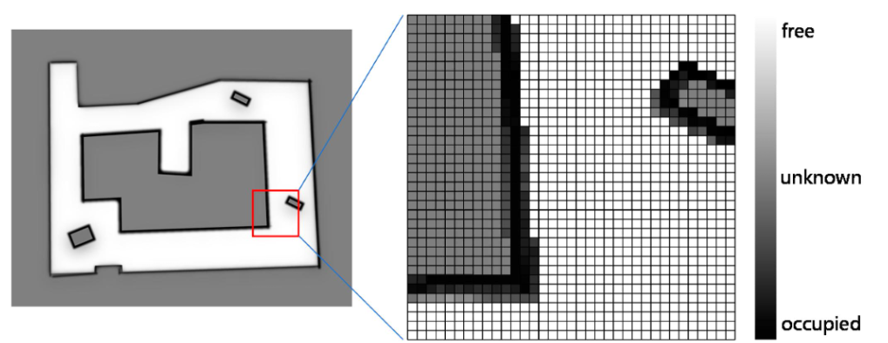
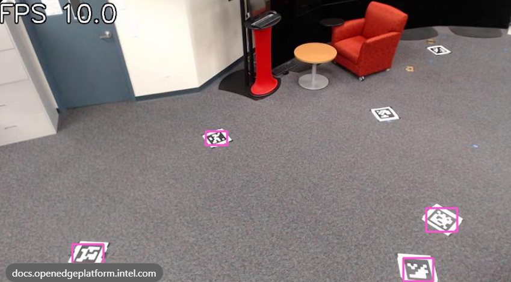
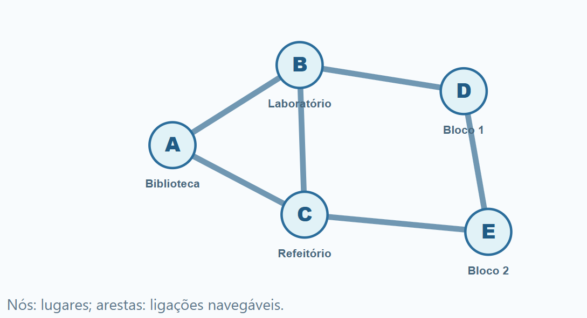

# Mapas

## Representações de mapas

### Mapa para um robô

&emsp;Mapa é uma representação computacional do ambiente. 

&emsp;E não precisa armazenar todas as informações possíveis do ambiente. Ele armazena as informações necessárias para determinada tarefa.

&emsp;4 categorias de representações:

1. Geométricas.
2. Topológicas.
3. Semânticas.
4. Híbridas

### Mapas geométricos

&emsp;Representam informações espaciais, como:

- Posições.
- Distâncias.
- Contornos.
- Ocupação do espaço.

&emsp;Existem diferentes formas de representar a geometria.

#### Occupancy Grid

&emsp;Mapa que divide o ambiente em pequenas células.

&emsp;Três estados importantes:

| Estado | Significado |
| :--- | :--- |
| Livre | As medições indicam ausência de obstáculo |
| Ocupado | As medições indicam presença de obstáculo |
| Desconhecido | Ainda não existem informações suficientes |

#### B) Landmarks

&emsp;Landmarks são referências reconhecíveis no ambiente, cujas posições podem ser estimadas.

&emsp;Exemplos:

- Um marcador visual.
- Um objeto específico.
- Uma placa.
- Uma característica arquitetônica.

&emsp;Imagine que um robô reconheça um marcador AprilTag em uma parede.

&emsp;Se ele conhece a posição desse marcador, pode utilizá-lo como referência para estimar sua própria localização.

#### C) Nuvem de pontos (Point Cloud)

&emsp;Conjunto de pontos que representam superfícies do ambiente em três dimensões.

&emsp;Nuvem de pontos registra amostras geométricas, enquanto o Occupancy Grid organiza o espaço em células com estados de ocupação.

&emsp;Uma nuvem de pontos não informa automaticamente quais regiões estão livres ou desconhecidas. Não representa necessariamente todo o espaço vazio entre eles.

### Mapas topológicos

&emsp;Agora imagine que o robô precise sair da biblioteca e chegar ao laboratório de outro prédio.

&emsp;Ele não precisa necessariamente representar cada parede e cada móvel do ambiente para decidir qual caminho seguir entre esses lugares.

&emsp;Representa:

- Lugares como nós.
- Conexões navegáveis como arestas.

&emsp;Podemos representar o mapa como um grafo: 
\[G=(V,E)\]

&emsp;Em que:

- \(V\) representa o conjunto de nós.
- \(E\) representa o conjunto de arestas.

&emsp;Uma aresta pode ter um peso, como:

- Distância.
- Tempo de deslocamento.
- Custo.
- Acessibilidade.

&emsp;**Vantagem**: é uma representação compacta e adequada para planejamento global em ambientes grandes.

&emsp;**Limitação**: não descreve necessariamente a geometria detalhada nem a proximidade dos obstáculos ao robô.

&emsp;Podemos combinar os dois tipos:

- Mapa topológico: escolhe para qual lugar ir.
- Mapa geométrico: permite atravessar o ambiente evitando obstáculos.

### Mapas semânticos

&emsp;Agora imagine que o robô identifique duas regiões livres no mapa.

&emsp;Uma delas é um corredor público. A outra é uma área de serviço restrita.

&emsp;Geometricamente, as duas regiões podem estar livres, mas não possuem o mesmo significado.

&emsp;Então, o mapa semântico adiciona informações sobre o significado dos elementos do ambiente.

&emsp;Um mapa semântico não substitui a geometria. O robô ainda precisa identificar e evitar colisões.

### Mapas híbridos

&emsp;Combina diferentes representações.

- Topologia para representar a conexão entre salas.

- Geometria para representar paredes e obstáculos.

- Semântica para identificar portas, elevadores e áreas restritas.

## Distance Transform (Distância até os obstáculos)

&emsp;Calcula a distância de cada célula livre até a célula ocupada mais próxima.

&emsp;Permite saber o quão perto cada região está de um obstáculo.

&emsp;Isso pode ser utilizado para:

- Avaliar a proximidade de obstáculos.
- Criar zonas de segurança.
- Atribuir custos para regiões próximas de obstáculos.
- Ajudar no planejamento de trajetórias.

### Distância L1: Manhattan

&emsp;Ela considera deslocamentos horizontais e verticais.

\[d_1(p,q)=|x_p-x_q|+|y_p-y_q|\]

### Distância L2: Euclidiana

&emsp;Representa a distância em linha reta entre dois pontos.

\[d_2(p,q)=\sqrt{(x_p-x_q)^2+(y_p-y_q)^2}\]

>Distância não é a mesma coisa que custo

#### Exemplo

&emsp;Uma célula está a 3 unidades na horizontal e 4 na vertical de um obstáculo. Qual é o par (L1, L2)?

\[L1=3+4=7\]

\[L2=\sqrt{3^2+4^2}=5\]

&emsp;Resposta:

\[\boxed{(7,5)}\]

## Mapas 

### Mapa 2D

&emsp;Não preserva adequadamente a informação de altura.

### Mapa 2,5D

&emsp;Além das coordenadas X e Y, o mapa armazene a altura do terreno em cada posição. Mas não representa o espaço tridimensional completo.

### Mapa 3D

&emsp;Consegue preservar a ocupação em diferentes alturas.

## Octree e OctoMap

&emsp;Octree é uma estrutura de dados utilizada para organizar informações espaciais em três dimensões.

&emsp;A ideia é dividir um volume em oito partes menores.

&emsp;Com uma Octree, podemos manter regiões maiores quando elas não precisam de detalhes. E subdividir apenas as regiões que exigem maior resolução.

### OctoMap

&emsp;Sistema de mapeamento 3D baseado na estrutura do Octree.

&emsp;Utiliza medições espaciais para estimar a ocupação dos volumes, ajudando na análise de colisões e no planejamento tridimensional.

&emsp;Pode receber informações de:

- Sensores de profundidade.
- Câmeras RGB-D.
- Nuvens de pontos 3D.

&emsp;**Ocupação é probabilística** - isso significa que o sistema mantém uma crença sobre a possibilidade de determinado volume estar ocupado. Conforme novas medições chegam, essa crença pode ser atualizada.

## Algoritmo A*: planejamento de caminhos

&emsp;É um algoritmo de busca utilizado para encontrar caminhos de menor custo entre um ponto inicial e um ponto de destino.

&emsp;O A* utiliza duas informações para decidir qual caminho explorar:

- Custo já percorrido.
- Estimativa do custo que ainda falta percorrer.

### Três componentes do A*

&emsp;A fórmula central é:
\[\boxed{f(n)=g(n)+h(n)}\]

&emsp;Vamos entender cada componente.

**1. \(g(n)\): custo real acumulado**

&emsp;Representa quanto custou sair do ponto inicial S e chegar até o nó atual \(n\).

**2. \(h(n)\): heurística**

&emsp;Representa uma estimativa do custo que falta para chegar ao objetivo G.

**3. \(f(n)\): custo estimado total**

&emsp;É a soma do custo já percorrido com a estimativa do custo restante:

### A*, Dijkstra e busca gulosa

#### O que é uma heurística?

&emsp;Uma heurística é uma função que estima o custo restante até o objetivo.

&emsp;Uma heurística é **admissível** quando nunca superestima o custo real mínimo que falta para chegar ao destino.

#### Busca gulosa (Greedy Best-First Search)

&emsp;A busca gulosa considera apenas a estimativa de distância até o destino

&emsp;Ela ignora quanto custou chegar até aquele nó.

#### Dijkstra

&emsp;Considera apenas o custo já percorrido

# Junção 2 aulas

1. **Estimar a própria pose**
   Aula 3: encoders, IMU e odometria ajudam o robô a estimar sua posição e orientação.

   ↓

2. **Representar o ambiente**
   Aula 4: Occupancy Grid, mapas topológicos, semânticos ou OctoMap representam o espaço.

   ↓

3. **Avaliar obstáculos**
   Distance Transform e costmaps ajudam a avaliar a proximidade de obstáculos e os custos das regiões.

   ↓

4. **Planejar o caminho**
   A* pode encontrar uma rota de menor custo até o destino.

   ↓

5. **Executar e acompanhar o movimento**
   O robô utiliza seus sensores e seu sistema de navegação para executar a trajetória e atualizar suas estimativas.