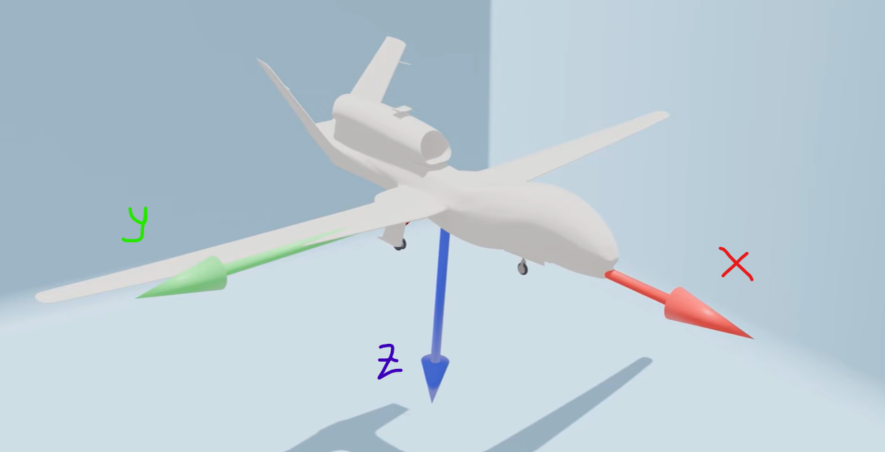
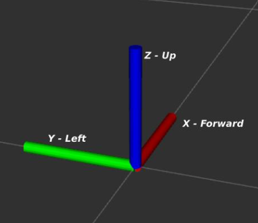

# Pose, transformações e odometria

## Posição, orientação e pose

### Posição 

&emsp;Representa onde o robô está localizado em determinado referencial.

&emsp;Por exemplo, imagine um robô em um ambiente:

- Está a 3 metros da origem no eixo X.
- Está a 2 metros da origem no eixo Y.

&emsp;Sua posição é:
\[(x,y)=(3,2)\]

&emsp;Mas isso ainda não informa para qual direção ele está apontando.

### Orientação

&emsp;Representa para qual direção o robô está voltado.

### Pose 

&emsp;É a combinação da posição com a orientação.

&emsp;A pose responde a duas perguntas:

1. Onde o robô está?
2. Para qual direção ele está apontando?

#### Pose em um ambiente 2D

&emsp;Na navegação de um robô terrestre, muitas vezes podemos simplificar o ambiente para duas dimensões.

&emsp;Nesse caso, a pose é representada por três parâmetros:
\[q=(x,y,\theta)\]

| Parâmetro | Significado |
| :--- | :--- |
| $x$ | Posição horizontal |
| $y$ | Posição vertical no plano |
| $\theta$ | Orientação do robô |

#### Pose em 3D: Roll, Pitch e Yaw

&emsp;Representação de um objeto no espaço tridimensional por meio de três ângulos, denominados **ângulos de Euler**.

| Ângulo | Eixo | Movimento intuitivo |
| :--- | :--- | :--- |
| Roll | X | Inclinação lateral |
| Pitch | Y | Inclinação para frente ou para trás |
| Yaw | Z | Giro para a direita ou esquerda |

&emsp;**Gimbal Lock** ocorre quando o Pitch chega a \(+90^\circ\) ou \(-90^\circ\), considerando a convenção ZYX utilizada na apresentação. Apresentando uma limitação dos ângulos.

&emsp;Os eixos associados às rotações de Roll e Yaw ficam alinhados. Com isso, perdemos a independência entre essas duas rotações na representação.

&emsp;Para contornar essa singularidade, podemos utilizar:

- Matrizes de rotação.
- Quaternions.

### Como representar a orientação em 3D?

#### Matriz de rotação

&emsp;É uma matriz \(3 \times 3\), utilizada para representar a orientação de um objeto no espaço 3D.

#### Quaternion

&emsp;É uma representação composta por quatro componentes:

\[(q_x,q_y,q_z,q_w)\]

## Referenciais e transformações de coordenadas

### Referencial

&emsp;Um referencial é um sistema de coordenadas utilizado para descrever a posição e a orientação de objetos.

&emsp;Por exemplo, podemos ter:

- Referencial global: representa o ambiente.
- Referencial do robô: representa a posição a partir do próprio robô.
- Referencial do sensor: representa a posição a partir do sensor.

&emsp;Existe um obstáculo a 1 metro à frente.

&emsp;Essa informação está expressa no referencial do sensor ou do robô, não necessariamente no referencial global.

&emsp;Para localizar esse obstáculo no mapa, precisamos conhecer:

1. A posição do robô no ambiente.
2. A orientação do robô.
3. A posição do sensor em relação ao robô.

### Convenção dos eixos no ROS

&emsp;Convenção REP 103 do ROS.

&emsp;Para o referencial do robô:

| Eixo | Direção |
| :--- | :--- |
| X | Frente do robô |
| Y | Esquerda do robô |
| Z | Acima do robô |

>Transformação homogênea permite converter coordenadas entre referenciais considerando simultaneamente **rotação** e **deslocamento/translação**.

## Descrição do deslocamento do robô

&emsp;Imagine um robô que está se deslocando por um corredor. Para descrever esse movimento, precisamos saber:

- Com que velocidade ele está avançando?
- Com que velocidade está girando?
- Em qual direção está se movimentando?

&emsp;Pose ao longo do tempo:

\[\xi(t)=
\begin{bmatrix}
x(t)\\
y(t)\\
\theta(t)
\end{bmatrix}\]

&emsp;Derivada da pose:

\[\dot{\xi}(t)=
\begin{bmatrix}
\dot{x}(t)\\
\dot{y}(t)\\
\dot{\theta}(t)
\end{bmatrix}\]

&emsp;Variação/derivada em x = velocidade em x
&emsp;Variação/derivada em y = velocidade em y
&emsp;Variação/derivada em teta = velocidade angular

### Twist

&emsp;Vetor que reúne as velocidades lineares e angulares de um corpo.

&emsp;Em três dimensões, ele possui seis componentes:

\[\mathbf{t}=
\begin{bmatrix}
v_x\\
v_y\\
v_z\\
\omega_x\\
\omega_y\\
\omega_z
\end{bmatrix}\]

### Restrição não holonômica

&emsp;Um **robô diferencial** utiliza rodas que permitem avançar, recuar e girar, mas não permitem um deslocamento lateral instantâneo no modelo ideal. Tipo que o carro precisa fazer baliza e não vai anda direto para direita/esquerda.

&emsp;**Robô omnidirecional** com rodas mecanum: pode realizar deslocamentos laterais.

## Sensores

&emsp;Os sensores não entregam diretamente a pose global do robô. Eles fornecem medições que precisam ser interpretadas por um modelo.

Três fontes principais:
1. Encoders.
2. Giroscópio.
3. Acelerômetro.

### Encoders

&emsp;Sensores que medem a rotação das rodas.
&emsp;O encoder registra a quantidade de pulsos ou a variação angular da roda.

&emsp;O encoder não mede diretamente a posição global do robô.
&emsp;Ele mede a rotação das rodas, que é utilizada para estimar o movimento.

### Giroscópio

&emsp;Mede a velocidade angular. Podendo estimar a variação da orientação por integração

&emsp;O giroscópio pode apresentar viés e ruído.

&emsp;Viés é um erro sistemático na medição. 
Erro acumulado é chamado de deriva (drift).

### Acelerômetro

&emsp;Mede aceleração específica nos eixos do sensor.

## Odometria

&emsp;É o processo de estimar o movimento e a pose de um robô ao longo do tempo utilizando medições de sensores e um modelo de movimento.

&emsp;O robô calcula sua posição global a partir das medições disponíveis.

### Possíveis erros

| Fonte | Possíveis erros |
| :--- | :--- |
| Encoders | Raio incorreto da roda, folga, escorregamento e quantização |
| Giroscópio | Viés e ruído acumulados na orientação |
| Acelerômetro | Erros de gravidade, viés e integração |

&emsp;`odom`: referencial local contínuo, cuja estimativa pode derivar.
&emsp;`map`: referencial global, que pode receber correções de localização.
&emsp;`base_link`: referencial associado ao próprio robô.

### Odometria visual

&emsp;VO monocular pura não consegue determinar a escala métrica absoluta do movimento sem informações adicionais.

&emsp;Câmeras estéreo ou RGB-D possuem informações de profundidade que auxiliam na obtenção da escala.

&emsp;VO estima o movimento relativo da câmera.

&emsp;SLAM estima simultaneamente a localização e constrói ou atualiza um mapa do ambiente.