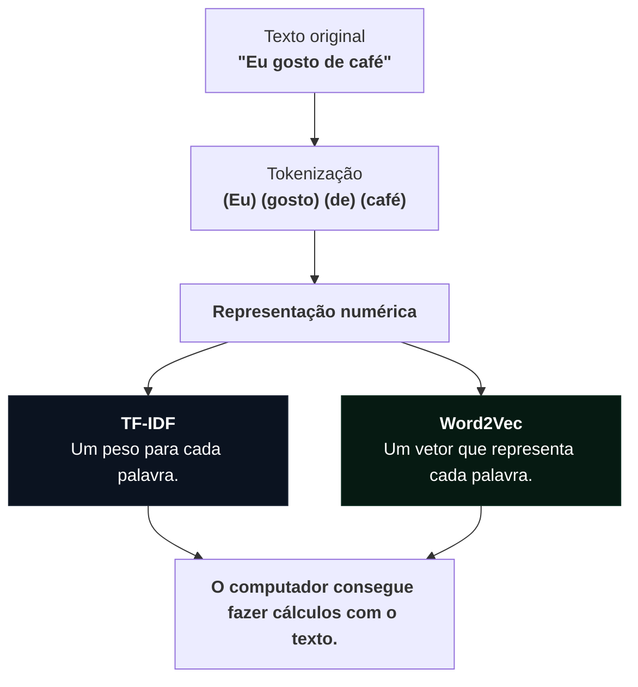
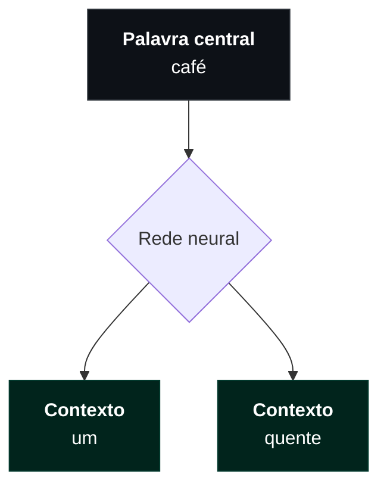
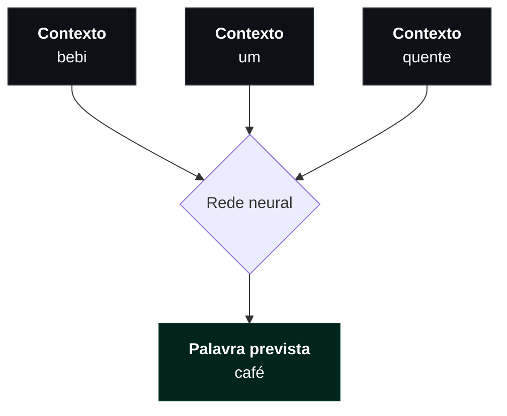

## Contexto

&emsp;1. **TF-IDF:** uma maneira de calcular a importância de cada palavra em um texto, considerando sua frequência e sua raridade em relação aos outros textos.

&emsp;2. **Word2Vec:** uma maneira de transformar palavras em vetores numéricos, de modo que palavras usadas em contextos semelhantes tenham representações matemáticas parecidas.

&emsp;O material tem quatro páginas HTML:

- [Introdução à transformação de texto em vetores](do-texto-aos-vetores.html)
- [Atividade interativa de TF-IDF](tfidf-a-mao.html)
- [Explicação interativa de Word2Vec](word2vec.html)
- [Atividade interativa de Word2Vec com cálculos manuais](word2vec-a-mao.html)

&emsp;Antes de estudar as duas técnicas, guarde dois conceitos:

- **Token:** uma unidade de texto, geralmente uma palavra. Na frase "gosto de café", temos três tokens.
- **Corpus:** conjunto de textos que estamos analisando. Se tivermos quatro avaliações de uma cafeteria, as quatro juntas formam o corpus.

## 1. Pré-processamento de texto

&emsp;Três textos sobre café:

- Um tweet: "não tomei o cafezinho!!! 😴 #café".
- Um trecho de livro: "O café fumegava na caneca."
- Um artigo científico: "A cafeína do café reduz o sono."

### 1.1. Tokenização

&emsp;Dividir um texto em partes menores chamadas tokens.

&emsp;Exemplo:

&emsp;Eu gosto muito de café →

&emsp;["Eu", "gosto", "muito", "de", "café"]

&emsp;O [site](do-texto-aos-vetores.html) compara duas formas de fazer isso:

**1. Separar pelos espaços**

&emsp;É a forma mais simples. O computador encontra os espaços e divide o texto.

&emsp;Problema: a pontuação fica grudada nas palavras.

&emsp;"cafezinho!!!" vira um único token.

**2. Usar um tokenizador**

&emsp;O site demonstra a biblioteca NLTK, que possui regras para reconhecer melhor as unidades do texto.

&emsp;Nesse caso:

&emsp;"cafezinho!!!" vira:

&emsp;["cafezinho", "!", "!", "!"]

> &emsp;Se queremos analisar palavras, geralmente não queremos tratar três pontos de exclamação como parte da palavra.

### 1.2. Vocabulário e identificadores

&emsp;Depois da tokenização, podemos montar um vocabulário, lista de todas as palavras diferentes encontradas nos textos.

&emsp;Imagine:

- Texto 1: eu gosto de café.
- Texto 2: eu gosto de chá.

&emsp;Vocabulário:

&emsp;["eu", "gosto", "de", "café", "chá"]

&emsp;As palavras repetidas aparecem apenas uma vez.

&emsp;O computador pode atribuir um número para cada palavra:

| Palavra | Identificador |
| :--- | :--- |
| eu | 0 |
| gosto | 1 |
| de | 2 |
| café | 3 |
| chá | 4 |

&emsp;Assim, o texto 1 pode ser representado por:

&emsp;[0, 1, 2, 3]

&emsp;E o texto 2:

&emsp;[0, 1, 2, 4]

> &emsp;O número 4 não significa que chá seja maior ou mais importante que café. É apenas uma posição na lista. Não representa o significado da palavra.

&emsp;Problema: se procurarmos "cafés", mas só temos "café", o identificador não existe.

### 1.3. Normalização

&emsp;Padronizar os tokens para evitar que diferenças superficiais sejam tratadas como palavras diferentes.

&emsp;Exemplos:

- Café → café.
- CAFÉ → café.
- café! → café (depois da remoção da pontuação).

&emsp;No site, são demonstradas duas operações:

- Converter tudo para minúsculas (`lower()`).
- Remover pontuação e símbolos, mantendo letras e números.

&emsp;Sem normalização, o computador poderia considerar Café, café e CAFÉ três palavras diferentes.

### 1.4. Stop words

&emsp;Stop words são palavras muito comuns que, em determinadas tarefas, podem não trazer muita informação.

&emsp;Exemplos em português:

- o
- a
- de
- do
- na
- e

&emsp;Exemplo:

&emsp;"Eu gosto de café."

&emsp;Depois de remover algumas stop words:

&emsp;"gosto café"

**Por que fazer isso?**

&emsp;Palavras como "de" e "o" aparecem tanto que não ajudam a distinguir um texto de outro.

> &emsp;Remover stop words não é obrigatório, depende da tarefa.

&emsp;O site mostra "não" na lista de stop words usada pelo NLTK, mas ela pode ser extremamente importante e removê-la alteraria completamente o sentido da frase.

&emsp;Exemplo:

&emsp;"Eu gostei do produto."

&emsp;"Eu não gostei do produto."

&emsp;Assim, a stop word é útil quando o foco está no significado central do texto.

### 1.5. Stemming e lematização

&emsp;Essas duas técnicas tentam reduzir palavras que possuem variações para uma forma comum.

&emsp;Imagine:

- estudar
- estudando
- estudou
- estudaremos

&emsp;Todas estão relacionadas ao verbo estudar.

**Stemming**

&emsp;Ele corta partes da palavra, geralmente sufixos, para encontrar um radical. É um processo mais simples.

&emsp;Exemplo:

&emsp;estudando → estud

&emsp;O resultado nem sempre é uma palavra existente no dicionário.

&emsp;No site, é utilizado o RSLPStemmer, da biblioteca NLTK para português.

**Lematização**

&emsp;Tenta encontrar a forma de dicionário da palavra, chamada de lema. É um processo mais linguístico.

&emsp;Exemplos:

- estudando → estudar
- estudou → estudar
- gatos → gato

&emsp;O site demonstra essa operação com a biblioteca spaCy.

&emsp;Diferenças:

| Stemming | Lematização |
| :--- | :--- |
| Corta partes da palavra | Procura a forma-base |
| Mais simples | Mais linguística |
| Pode gerar fragmentos | Busca uma palavra válida |

### 1.6. Subpalavras: BPE (Byte Pair Encoding)

&emsp;Em vez de considerar cada palavra inteira como uma unidade, podemos dividi-la em pedaços menores.

&emsp;Imagine a palavra:

&emsp;cafezinho

&emsp;Ela poderia ser dividida em:

&emsp;café + zinho

&emsp;Ou em outras combinações de caracteres, dependendo do treinamento.

**Como o BPE funciona?**

1. Começa dividindo as palavras em caracteres.
2. Conta quais pares de caracteres aparecem juntos com maior frequência.
3. Junta o par mais frequente em uma nova unidade.
4. Repete o processo.

&emsp;Isso ajuda a lidar com palavras que não apareceram exatamente daquela forma durante o treinamento.

&emsp;Por exemplo, se o modelo conhece café e aprende o sufixo s, pode conseguir representar cafés usando unidades que já conhece.

&emsp;Essa técnica é muito utilizada em tokenizadores de modelos de linguagem.

## 2. Bag of Words (BoW, ou saco de palavras): transformando textos em tabelas

&emsp;Agora chegamos à primeira representação numérica que prepara o terreno para TF-IDF.

&emsp;Representar cada texto contando quantas vezes cada palavra aparece nele.

&emsp;Imagine dois textos:

- Documento 1: "gosto de café".
- Documento 2: "gosto de chá".

&emsp;Nosso vocabulário é:

&emsp;["café", "chá", "de", "gosto"]

&emsp;Podemos construir uma tabela:

| Documento | café | chá | de | gosto |
| :--- | :--- | :--- | :--- | :--- |
| 1 | 1 | 0 | 1 | 1 |
| 2 | 0 | 1 | 1 | 1 |

&emsp;Essa tabela é chamada de matriz documento × termo.

- Cada linha representa um documento.
- Cada coluna representa uma palavra.
- Cada célula representa quantas vezes aquela palavra aparece no documento.

&emsp;Isso também é chamado de TF (Term Frequency) quando estamos considerando a contagem da palavra em cada texto.

> &emsp;Limitação: BoW não considera a ordem das palavras.

&emsp;Por exemplo:

- "O cachorro mordeu o homem."
- "O homem mordeu o cachorro."

&emsp;As duas frases possuem praticamente as mesmas palavras e contagens, mas significados diferentes.

&emsp;O BoW não consegue perceber essa diferença.

### 2.1. N-gramas: considerando combinações de palavras

&emsp;Para diminuir essa limitação, o site também demonstra n-gramas.

&emsp;Um n-grama é uma sequência de N palavras consecutivas.

- Unigrama: uma palavra.
- Bigramas: duas palavras consecutivas.
- Trigramas: três palavras consecutivas.

&emsp;Exemplo:

&emsp;"tomei café não chá"

&emsp;Unigramas:

- tomei
- café
- não
- chá

&emsp;Bigramas:

- tomei café
- café não
- não chá

&emsp;O site compara estas frases:

1. "tomei café, não chá".
2. "tomei chá, não café".

&emsp;Com unigramas, as duas possuem exatamente as mesmas palavras e contagens.

&emsp;Com bigramas, conseguimos perceber diferenças na ordem e nas combinações.

**Ideia principal:** n-gramas acrescentam um pouco de informação contextual ao Bag of Words, mas ainda não compreendem o significado das frases.

## 3. TF-IDF: descobrindo quais palavras são importantes

&emsp;Técnica que atribui um peso para cada palavra de cada documento.

&emsp;A pergunta que ele tenta responder é:

&emsp;Quais palavras são mais importantes para identificar ou diferenciar este texto dos demais?

&emsp;Pense em duas situações:

- Uma palavra aparece muitas vezes em um documento.
- Uma palavra aparece em poucos documentos do corpus.

&emsp;As duas situações são relevantes, mas de maneiras diferentes.

&emsp;O TF-IDF combina essas duas informações.

### 3.1. TF: Term Frequency (Frequência do termo)

&emsp;É a quantidade de vezes que uma palavra aparece em determinado documento.

&emsp;Exemplo:

&emsp;Documento:

&emsp;"Eu gosto de café. Café é muito bom."

| Palavra | TF |
| :--- | :--- |
| eu | 1 |
| gosto | 1 |
| de | 1 |
| café | 2 |
| é | 1 |
| muito | 1 |
| bom | 1 |

&emsp;A palavra café tem TF = 2 porque aparece duas vezes.

&emsp;Na atividade do professor, o TF é simplesmente a contagem absoluta, sem divisão pelo tamanho do documento.

### 3.2. DF: Document Frequency

&emsp;Agora imagine que temos quatro documentos.

&emsp;O DF responde:

&emsp;Em quantos documentos diferentes essa palavra aparece?

&emsp;Não importa quantas vezes ela aparece dentro de cada documento. Importa em quantos documentos ela está presente.

&emsp;Exemplo:

| Documento | café | leite |
| :--- | :--- | :--- |
| 1 | 2 | 1 |
| 2 | 1 | 0 |
| 3 | 3 | 0 |
| 4 | 1 | 0 |

&emsp;Temos:

- DF(café) = 4, porque café aparece nos quatro documentos.
- DF(leite) = 1, porque leite aparece somente no documento 1.

&emsp;Perceba a diferença:

- TF conta ocorrências dentro de um documento.
- DF conta documentos que contêm a palavra.

### 3.3. IDF: Inverse Document Frequency (frequência inversa de documentos)

&emsp;A ideia é dar mais importância às palavras que aparecem em poucos documentos e menos importância às palavras que aparecem em quase todos.

&emsp;A fórmula utilizada pelo professor é:

$$IDF(t) = \log_2 \left( \frac{N}{DF(t)} \right)$$

&emsp;Onde:

- \(N\): quantidade total de documentos.
- \(DF(t)\): quantidade de documentos que contêm a palavra.
- \(\log_2\): logaritmo na base 2.

&emsp;Vamos entender o que acontece.

&emsp;Imagine que temos quatro documentos.

| DF | N / DF | IDF |
| :--- | :--- | :--- |
| 4 | 4/4 = 1 | 0 |
| 2 | 4/2 = 2 | 1 |
| 1 | 4/1 = 4 | 2 |

&emsp;Portanto:

- Se uma palavra aparece em todos os documentos, IDF = 0.
- Se aparece em metade dos documentos, IDF = 1.
- Se aparece em apenas um documento, IDF = 2.

**Por que uma palavra comum recebe peso zero?**

&emsp;Porque ela não ajuda a distinguir um documento dos outros.

&emsp;Imagine que todos os documentos de uma cafeteria falem sobre café. A palavra "café" aparece em todos eles.

&emsp;Saber que um documento contém a palavra café não ajuda a identificar qual avaliação estamos lendo.

&emsp;Já a palavra "canela", que pode aparecer em apenas uma avaliação, ajuda muito mais a diferenciá-la.

### 3.4. TF-IDF: juntando as duas medidas

$$TFIDF(t,d) = TF(t,d) \times IDF(t)$$

- TF mede quantas vezes a palavra aparece naquele documento.
- IDF mede o quanto ela é rara no corpus.
- TF-IDF combina as duas coisas.

&emsp;Uma palavra terá peso alto quando aparecer bastante no documento e for relativamente rara no conjunto de documentos.

**Uma analogia**

&emsp;Imagine que você está tentando identificar qual aluno escreveu uma redação.

&emsp;Todos os alunos utilizam palavras como "o", "a", "de" e "que". Essas palavras não ajudam muito a identificar o autor.

&emsp;Mas imagine que apenas um aluno utiliza várias vezes a palavra "astronomia".

&emsp;Essa palavra é muito mais característica daquela redação.

&emsp;É justamente essa ideia que o TF-IDF tenta capturar.

> **O que você precisa saber fazer em uma prova de TF-IDF:**
>
> 1. Identificar o vocabulário.
> 2. Construir a matriz documento × termo.
> 3. Calcular o TF.
> 4. Calcular o DF.
> 5. Aplicar a fórmula do IDF.
> 6. Multiplicar TF × IDF.
> 7. Interpretar o significado dos pesos.

## 4. Similaridade de cosseno

&emsp;Ele mostra como podemos utilizar os vetores TF-IDF para comparar documentos e fazer buscas.

&emsp;Mas como comparamos dois vetores?

&emsp;Utilizamos a similaridade de cosseno.

&emsp;A ideia é medir o ângulo entre dois vetores:

- Cosseno próximo de 1: vetores apontam para direções semelhantes.
- Cosseno próximo de 0: vetores são aproximadamente perpendiculares.
- Cosseno próximo de -1: vetores apontam em direções opostas.

&emsp;A fórmula é por produto escalar.

&emsp;Isso é uma das ideias por trás dos sistemas de busca textual.

## 5. Word2Vec: ensinando o computador a representar palavras pelo contexto

&emsp;O TF-IDF responde:

&emsp;"Quais palavras são importantes para identificar este documento?"

&emsp;O Word2Vec tenta responder outra pergunta:

**Como representar uma palavra numericamente de modo que palavras utilizadas em contextos semelhantes tenham vetores semelhantes?**

### 5.1. A ideia da hipótese distribucional

&emsp;De forma simplificada:

&emsp;Palavras que aparecem em contextos semelhantes tendem a ter significados ou funções semelhantes.

&emsp;Vamos imaginar estas frases:

- Eu bebi café quente.
- Eu bebi chá quente.
- Eu bebi leite quente.

&emsp;Observe:

&emsp;A palavra café aparece próxima de "bebi" e "quente".

&emsp;A palavra chá também aparece próxima de "bebi" e "quente".

&emsp;A palavra leite também poderia aparecer nos mesmos contextos.

&emsp;Mesmo que o computador não saiba o que é café ou chá, ele consegue perceber que essas palavras são utilizadas de maneira semelhante.

&emsp;É essa informação que o Word2Vec tenta aprender.

### 5.2. O que é um embedding?

&emsp;Representação de uma palavra por meio de um vetor numérico.

&emsp;Os embeddings podem possuir dezenas, centenas ou milhares de dimensões.

&emsp;E o computador não recebe uma definição pronta de cada palavra. Ele aprende os números durante o treinamento.

### 5.3. Como o Word2Vec aprende?

&emsp;A ideia é treinar uma rede neural para prever relações entre palavras.

&emsp;Exemplo:

- bebi café quente.
- bebi chá quente.
- bebi xurupa quente.

&emsp;Xurupa é uma palavra inventada. Não sabemos o que significa.

&emsp;Entretanto, ela aparece exatamente no mesmo contexto de café e chá.

&emsp;A hipótese é que, durante o treinamento, o Word2Vec perceba que xurupa possui um comportamento contextual semelhante ao de café e chá.

&emsp;Para entender isso, precisamos aprender quatro conceitos.

**A. Janela de contexto (window)**

&emsp;A janela define quantas palavras ao redor de uma palavra serão consideradas como contexto.

&emsp;Exemplo:

&emsp;"bebi café quente"

&emsp;Com janela 1:

- Contexto de bebi: café.
- Contexto de café: bebi e quente.
- Contexto de quente: café.

&emsp;Se aumentarmos a janela para 2, poderíamos considerar palavras ainda mais distantes.

&emsp;Portanto, o tamanho da janela influencia quais relações o modelo aprende.

**B. Pares de treinamento**

&emsp;No Word2Vec, transformamos as frases em exemplos de treinamento.

&emsp;Com janela 1, a frase:

&emsp;"bebi café quente"

&emsp;Gera:

| Entrada | Contexto |
| :--- | :--- |
| bebi | café |
| café | bebi |
| café | quente |
| quente | café |

&emsp;Cada par é uma tarefa de aprendizado.

&emsp;Por exemplo:

&emsp;café → quente

&emsp;A rede recebe café e tenta prever quente.

&emsp;Se ela conseguir prever corretamente os contextos das palavras, estará aprendendo a estrutura de utilização dessas palavras.

**C. W_in e W_out**

&emsp;Essa é provavelmente a parte mais importante para entender os cálculos do exercício.

&emsp;O Word2Vec utiliza duas matrizes de pesos:

- \(W_{in}\): pesos utilizados para representar a palavra de entrada.
- \(W_{out}\): pesos utilizados para representar as palavras que podem ser previstas como saída.

&emsp;Cada palavra possui uma linha em cada matriz.

&emsp;Imagine que estamos usando apenas duas dimensões:

| Palavra | W_in (x, y) |
| :--- | :--- |
| café | (1, 2) |
| chá | (2, -1) |
| quente | (2, 1) |

&emsp;Esses valores são os pesos aprendidos pela rede.

&emsp;Quando recebemos café como entrada, pegamos seu vetor em \(W_{in}\).

&emsp;Para cada palavra possível de saída, usamos sua linha em \(W_{out}\).

**D. A rede calcula pontuações**

&emsp;A rede compara o vetor de entrada com cada possível saída usando o produto escalar.

&emsp;A fórmula é:

\[\text{pontuação}(i,j)=W_{in}(i)\cdot W_{out}(j)\]

&emsp;Com duas dimensões:

\[s=x_{in}x_{out}+y_{in}y_{out}\]

&emsp;Quanto maior a pontuação, maior a tendência de a rede prever aquela palavra.

&emsp;Mas precisamos transformar essas pontuações em probabilidades.

&emsp;Para isso, usamos a função Softmax:

\[P_j=\frac{e^{s_j}}{\sum_k e^{s_k}}\]

&emsp;O que ela faz?

1. Recebe as pontuações.
2. Aplica a exponencial em cada uma.
3. Divide cada resultado pela soma das exponenciais.

&emsp;O resultado é uma distribuição de probabilidades.

&emsp;Todas as probabilidades somadas precisam dar 1 (ou aproximadamente 1, devido ao arredondamento).

&emsp;Exemplo:

| Palavra | Probabilidade |
| :--- | :--- |
| bebi | 0,15 |
| café | 0,40 |
| chá | 0,15 |
| quente | 0,15 |
| xurupa | 0,15 |
| Total | 1,00 |

&emsp;Isso significa que, para aquela entrada, a rede está apostando mais em café.

&emsp;Mas, se o par de treinamento for café → quente, queremos que a probabilidade de quente aumente.

&emsp;É aí que entra o erro e a correção dos pesos.

**Insights dos exercícios**

&emsp;Época é uma passagem completa pelo conjunto de exemplos de treinamento.

&emsp;Embedding de cada palavra é seu vetor na W_in depois do treinamento.

**Skip-gram**

&emsp;Arquitetura de receber uma palavra e tentar prever as palavras ao redor dela.

&emsp;Exemplo:

&emsp;"bebi um café quente"

&emsp;Se a entrada for café, a rede tenta prever palavras como "um" e "quente", considerando a janela de contexto.

**CBOW (Continuous Bag of Words)**

&emsp;Aqui acontece o contrário:

&emsp;A rede recebe as palavras do contexto e tenta prever a palavra central.

&emsp;Exemplo:

&emsp;"bebi um ___ quente"

&emsp;O modelo recebe o contexto e tenta descobrir que a palavra central é café.

&emsp;Diferenças:

| Skip-gram | CBOW |
| :--- | :--- |
| Entrada: palavra central | Entrada: palavras do contexto |
| Saída: palavras vizinhas | Saída: palavra central |
| Palavra → contexto | Contexto → palavra |

&emsp;Semelhanças: ambos aprendem embeddings a partir das relações entre palavras.

## Comparação: TF-IDF versus Word2Vec

&emsp;Essa comparação é muito importante porque os dois assuntos têm objetivos relacionados, mas não são a mesma coisa.

| Característica | TF-IDF | Word2Vec |
| :--- | :--- | :--- |
| O que produz? | Pesos para palavras em documentos | Vetores para palavras |
| Como aprende? | Calcula frequências | Treina uma rede neural |
| Considera frequência? | Sim | Indiretamente, pelos exemplos |
| Considera contexto? | Não diretamente | Sim |
| Representa significado? | Não | Captura relações semânticas e sintáticas de maneira aproximada |
| Palavra fora do vocabulário | Não possui representação | Também não possui embedding aprendido |
| Exemplo de uso | Busca de documentos | Similaridade entre palavras |

&emsp;Vamos imaginar que temos:

- "Eu gosto de café."
- "Eu gosto de chá."

**Com TF-IDF:**

&emsp;O computador calcula o peso das palavras em cada documento.

&emsp;Ele pode identificar quais palavras ajudam a diferenciar as frases.

**Com Word2Vec:**

&emsp;O computador aprende que café e chá aparecem em contextos semelhantes.

&emsp;Por isso, seus embeddings podem ficar próximos.

**Uma diferença muito importante:**

&emsp;No TF-IDF, cada documento recebe um vetor de pesos das palavras.

&emsp;No Word2Vec, cada palavra recebe um vetor aprendido.

&emsp;É possível combinar as duas técnicas, mas elas não são intercambiáveis.