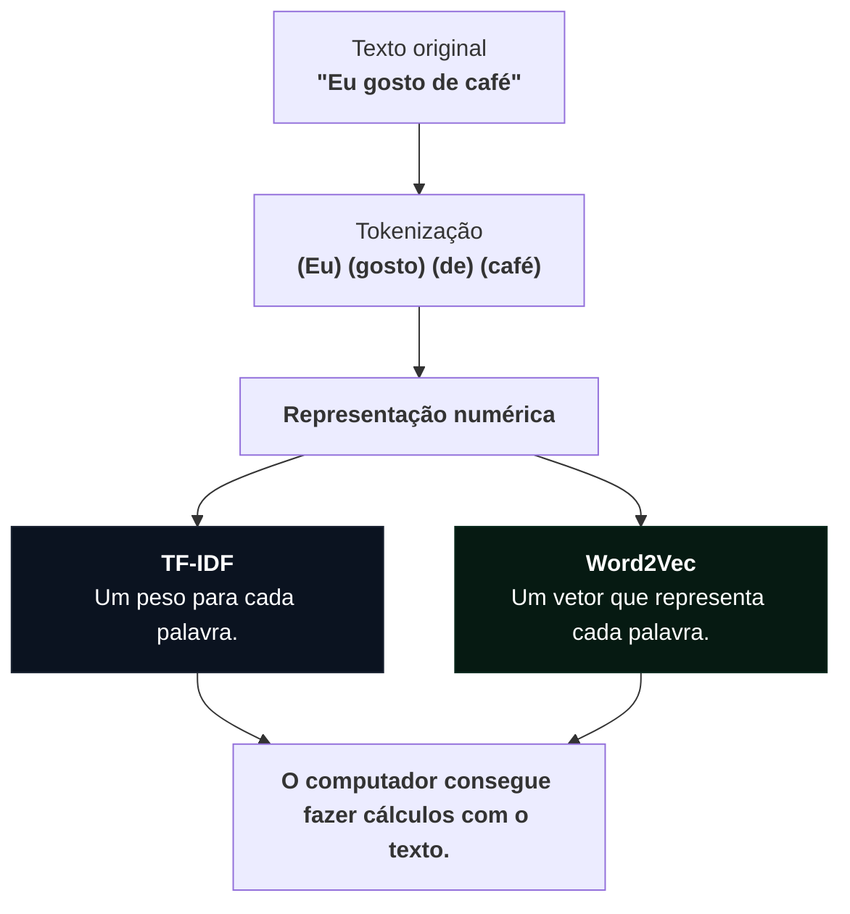

## Contexto

1. TF-IDF: uma maneira de calcular a importância de cada palavra em um texto, considerando sua frequência e sua raridade em relação aos outros textos.

2. Word2Vec: uma maneira de transformar palavras em vetores numéricos, de modo que palavras usadas em contextos semelhantes tenham representações matemáticas parecidas.

O material tem quatro páginas HTML:
- [introdução à transformação de texto em vetores](do-texto-aos-vetores.html)
- [atividade interativa de TF-IDF](tfidf-a-mao.html)
- [explicação interativa de Word2Vec](word2vec.html)
- [atividade interativa de Word2Vec com cálculos manuais](word2vec-a-mao.html)

Antes de estudar as duas técnicas, guarde dois conceitos:
- Token: uma unidade de texto, geralmente uma palavra. Na frase "gosto de café", temos três tokens.
- Corpus: conjunto de textos que estamos analisando. Se tivermos quatro avaliações de uma cafeteria, as quatro juntas formam o corpus.

## 2. Pré-processamento de texto

três textos sobre café:
- Um tweet: "não tomei o cafezinho!!! 😴 #café"
- Um trecho de livro: "O café fumegava na caneca."
- Um artigo científico: "A cafeína do café reduz o sono."

### 2.1 Tokenização
dividir um texto em partes menores chamadas tokens.

Exemplo: 
Eu gosto muito de café -> 
["Eu", "gosto", "muito", "de", "café"]

O [site](do-texto-aos-vetores.html) compara duas formas de fazer isso:

1. Separar pelos espaços

É a forma mais simples. O computador encontra os espaços e divide o texto.

Problema: a pontuação fica grudada nas palavras.

"cafezinho!!!" vira um único token.

2. Usar um tokenizador

O site demonstra a biblioteca NLTK, que possui regras para reconhecer melhor as unidades do texto.

Nesse caso:

"cafezinho!!!" vira:

["cafezinho", "!", "!", "!"]

> Se queremos analisar palavras, geralmente não queremos tratar três pontos de exclamação como parte da palavra.

### 2.2. Vocabulário e identificadores
Depois da tokenização, podemos montar um vocabulário, lista de todas as palavras diferentes encontradas nos textos.

Imagine:
- Texto 1: eu gosto de café
- Texto 2: eu gosto de chá

Vocabulário:
["eu", "gosto", "de", "café", "chá"]

As palavras repetidas aparecem apenas uma vez.

O computador pode atribuir um número para cada palavra:

| Palavra | Identificador |
| :--- | :--- |
| eu | 0 |
| gosto | 1 |
| de | 2 |
| café | 3 |
| chá | 4 |

Assim, o texto 1 pode ser representado por:

[0, 1, 2, 3]

E o texto 2:

[0, 1, 2, 4]

> O número 4 não significa que chá seja maior ou mais importante que café. É apenas uma posição na lista. Não representa o significado da palavra.

Problema: Se procurarmos "cafés", mas só temos "café", o identificador não existe.

### 2.3. Normalização

Padronizar os tokens para evitar que diferenças superficiais sejam tratadas como palavras diferentes.

Exemplos:
- Café → café
- CAFÉ → café
- café! → café (depois da remoção da pontuação)
No site, são demonstradas duas operações:
- Converter tudo para minúsculas (lower()).
- Remover pontuação e símbolos, mantendo letras e números.

Sem normalização, o computador poderia considerar Café, café e CAFÉ três palavras diferentes.

### 2.4. Stop words

Stop words são palavras muito comuns que, em determinadas tarefas, podem não trazer muita informação.

Exemplos em português:
- o
- a
- de
- do
- na
- e

Exemplo:

"Eu gosto de café"

Depois de remover algumas stop words:

"gosto café"

**Por que fazer isso?** palavras como "de" e "o" aparecem tanto que não ajudam a distinguir um texto de outro.

> Remover stop words não é obrigatório,depende da tarefa

o site mostra "não" na lista de stop words usada pelo NLTK, mas ela pode ser extremamente importante e removê-la alteraria completamente o sentido da frase 

exemplo:
"Eu gostei do produto."
"Eu não gostei do produto."

Assim, o stop word é útil quando o foco está no significado central do texto.

### 2.5. Stemming e lematização
Essas duas técnicas tentam reduzir palavras que possuem variações para uma forma comum.

Imagine:
- estudar
- estudando
- estudou
- estudaremos
Todas estão relacionadas ao verbo estudar.

**Stemming**

Ele corta partes da palavra, geralmente sufixos, para encontrar um radical. É um processo mais simples.

Exemplo:

estudando → estud

O resultado nem sempre é uma palavra existente no dicionário.

No site, é utilizado o RSLPStemmer, da biblioteca NLTK para português.

**Lematização**

Tenta encontrar a forma de dicionário da palavra, chamada de lema. É um processo mais linguístico.

Exemplos:
- estudando → estudar
- estudou → estudar
- gatos → gato
O site demonstra essa operação com a biblioteca spaCy.

Diferenças:

| Stemming | Lematização |
| :--- | :--- |
| Corta partes da palavra | Procura a forma-base |
| Mais simples | Mais linguística |
| Pode gerar fragmentos | Busca uma palavra válida |

### 2.6. Subpalavras: BPE (Byte Pair Encoding).

Em vez de considerar cada palavra inteira como uma unidade, podemos dividi-la em pedaços menores.

Imagine a palavra:

cafezinho

Ela poderia ser dividida em:

café + zinho

Ou em outras combinações de caracteres, dependendo do treinamento.

Como o BPE funciona?
1. Começa dividindo as palavras em caracteres.
2. Conta quais pares de caracteres aparecem juntos com maior frequência.
3. Junta o par mais frequente em uma nova unidade.
4. Repete o processo.
Isso ajuda a lidar com palavras que não apareceram exatamente daquela forma durante o treinamento.

Por exemplo, se o modelo conhece café e aprende o sufixo s, pode conseguir representar cafés usando unidades que já conhece.

Essa técnica é muito utilizada em tokenizadores de modelos de linguagem.