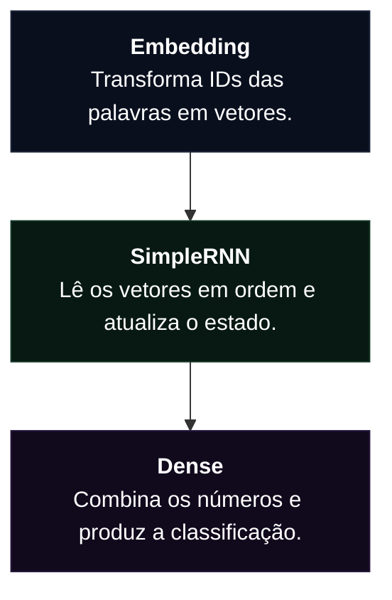

# RNN (Redes Neurais Recorrentes)

## O que a RNN resolve

&emsp;Uma rede neural tradicional recebe uma entrada e produz uma saída. Porém, existem problemas em que a ordem das informações importa, como no processamento de frases.

&emsp;Tarefa: classificar uma frase como positiva (1) ou negativa (0).

| Frase | Classificação |
| :--- | :--- |
| o café já estava hoje aqui bom | 1 |
| o café já estava hoje aqui ruim | 0 |
| o café não estava hoje aqui bom | 0 |
| o café não estava hoje aqui ruim | 1 |

&emsp;Observe que a classificação depende da combinação de duas palavras: "não" e o adjetivo.

&emsp;A dificuldade é que, quando a rede chega ao adjetivo, ela não pode voltar para reler a frase. Precisa utilizar as informações que guardou durante a leitura.

&emsp;É justamente essa a ideia das redes recorrentes.

## Como funciona uma RNN

&emsp;Consegue considerar o que apareceu anteriormente na frase enquanto lê as próximas palavras.

RNN começa pela primeira palavra e vai percorrendo a frase na ordem. Ela não processa todas as palavras simultaneamente.

Quando a RNN recebe a primeira palavra, ela faz duas coisas:
1. Recebe a representação numérica da palavra atual.
2. Atualiza seu estado interno/estado oculto (hidden state) - conjunto de números que representa as informações que a rede está carregando naquele momento.

### Vamos acompanhar palavra por palavra

Exemplo: o café não estava bom

**Primeira palavra: “O”** ($h_0 \rightarrow h_1$)

&emsp;A rede recebe a representação numérica de “O”.

&emsp;Como é a primeira palavra, ainda não existe informação anterior da frase. Portanto, começamos com um estado inicial, geralmente zerado.

&emsp;A RNN combina a palavra atual com esse estado inicial e produz um novo estado.

&emsp;Estado inicial + palavra atual:

$$h_0 + \text{entrada de O} \rightarrow \mathbf{h_1}$$

&emsp;A rede não está simplesmente guardando a palavra “O”. Ela está transformando a informação recebida em um conjunto de números.

**Segunda palavra: “café”**

&emsp;Agora a rede recebe “café”.

&emsp;Mas existe uma diferença importante: ela não começa do zero novamente!

&emsp;Ela já possui o estado anterior, \(h_1\), produzido quando leu “O”.

&emsp;Então, combina:
- A representação numérica de “café”.
- O estado anterior \(h_1\).

&emsp;E produz um novo estado, \(h_2\).

&emsp;Estado anterior + palavra atual:

$$h_1 + \text{entrada de café} \rightarrow \mathbf{h_2}$$

\(h_2\) carrega informações resultantes da leitura de “O café”.

**Terceira palavra: “não”**

&emsp;A RNN recebe “não” e combina essa entrada com \(h_2\).

&emsp;O resultado é \(h_3\).

&emsp;Agora, o estado carrega informações da sequência “O café não”.

&emsp;A rede não precisa voltar até o começo da frase para consultar as palavras anteriores. Ela utiliza o estado que foi sendo atualizado ao longo da leitura.

$$h_2 + \text{entrada de não} \rightarrow \mathbf{h_3}$$

**Quarta palavra: “estava”**

&emsp;A rede recebe “estava” e combina com \(h_3\).

&emsp;Produz \(h_4\), que carrega informações resultantes da leitura de “O café não estava”.

$$h_3 + \text{entrada de estava} \rightarrow \mathbf{h_4}$$

**Quinta palavra: “bom”**

&emsp;Por último, recebe “bom” e combina com \(h_4\).

&emsp;Produz \(h_5\), o estado final da frase.

$$h_3 + \text{entrada de bom} \rightarrow \mathbf{h_5}$$

&emsp;O raciocínio é sempre o mesmo:

1. Recebe uma palavra.
2. Combina essa palavra com o estado anterior.
3. Calcula um novo estado.
4. Passa esse novo estado para a próxima etapa.

&emsp;RNN possui memória: carrega informações anteriores por meio do estado oculto.

### Como ela sabe combinar essas informações?

&emsp;Matematicamente, uma RNN possui pesos (parâmetros) que determinam como a entrada atual e o estado anterior serão combinados. 

&emsp;Fórmula simplificada:

\[h_t = \tanh(W_x x_t + W_h h_{t-1} + b)\]

| Elemento | Significado |
| :--- | :--- |
| $x_t$ | Representação da palavra atual |
| $h_{t-1}$ | Estado anterior |
| $W_x$ | Pesos aplicados à entrada atual |
| $W_h$ | Pesos aplicados ao estado anterior |
| $b$ | Viés |
| $\tanh$ | Função de ativação |
| $h_t$ | Novo estado produzido |

&emsp;RNN aprende, durante o treinamento, os pesos que permitem combinar a palavra atual com as informações anteriores.

&emsp;O estado não guarda literalmente uma lista de palavras. Ele é um vetor numérico que representa informações aprendidas pela rede.

### RNN é a mesma em todas as palavras

&emsp;Imagine que temos cinco palavras. Não são cinco redes diferentes. É a mesma célula RNN sendo utilizada cinco vezes, com os mesmos pesos.

&emsp;O que muda a cada etapa é:
- A palavra recebida.
- O estado anterior.
- O novo estado produzido.

&emsp;E existe uma diferença importante entre ler uma frase e treinar a rede:
- Durante a leitura, o estado muda a cada palavra.
- Durante o treinamento, os pesos são ajustados para melhorar as previsões.

&emsp;Quando uma frase nova começa, o estado é reiniciado. Mas os pesos aprendidos continuam os mesmos.

## O que a RNN devolve: `return_sequences`

&emsp;Durante a leitura, a RNN calcula um estado para cada palavra. Entretanto, podemos escolher quais informações serão entregues pela camada.

&emsp;Essa escolha é feita pelo parâmetro return_sequences.

&emsp;`return_sequences=False`: quando queremos uma classificação por frase. Uma camada Dense recebe o último estado e produz a resposta.

&emsp;`return_sequences=True`: quando queremos entregar a sequência completa de estados, por exemplo, para alimentar outra RNN.

&emsp;Exemplo: Considere uma frase com 13 palavras e uma RNN com 16 unidades.

| Configuração | Saída | Utilização |
| :--- | :--- | :--- |
| False | (None, 16) | Entrega somente o último estado, um vetor por frase. |
| True | (None, 13, 16) | Entrega o estado de cada palavra. |

None: quantidade de frases no lote, variável.
13: quantidade de palavras por frase.
16: quantidade de números no estado.

o último vetor da sequência, quando return_sequences=True, é o mesmo que seria entregue com return_sequences=False.????????

## Como montar uma rede RNN com Keras

### Embedding

&emsp;O texto inicialmente é representado por IDs numéricos.

Por exemplo:
- `o` → 0
- `café` → 1
- `não` → 4

&emsp;O problema é que a RNN precisa receber um vetor para cada palavra, e não apenas um número que identifica a palavra.

&emsp;A camada Embedding transforma cada ID em um vetor de dimensão definida.

&emsp;Por exemplo, se a dimensão for 8, cada palavra será representada por um vetor com 8 números.

&emsp;Assim:
- Antes da `Embedding`: `(None, 13)`.
- Depois da `Embedding`: `(None, 13, 8)`.

### SimpleRNN

&emsp;Recebe os vetores da Embedding, processa a sequência e mantém o estado recorrente.

&emsp;O número de unidades determina quantos números compõem esse estado.

### Dense

&emsp;Recebe os números produzidos pela RNN e combina essas informações para gerar a classificação.

&emsp;No material, utiliza-se Dense(1) com ativação sigmoid.

&emsp;A função sigmoid transforma a saída em um valor entre 0 e 1, interpretado como probabilidade da frase pertencer à classe positiva.
- Resultado maior que 0,5: classificação positiva (1).
- Resultado menor ou igual a 0,5: classificação negativa (0).

## Quantidade de parâmetros

## Treinamento e avaliação

## O que significa a rede aprender a informação?

## Inicialização dos pesos recorrentes

## Bugs e problemas de avaliação