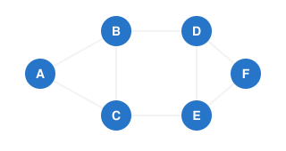
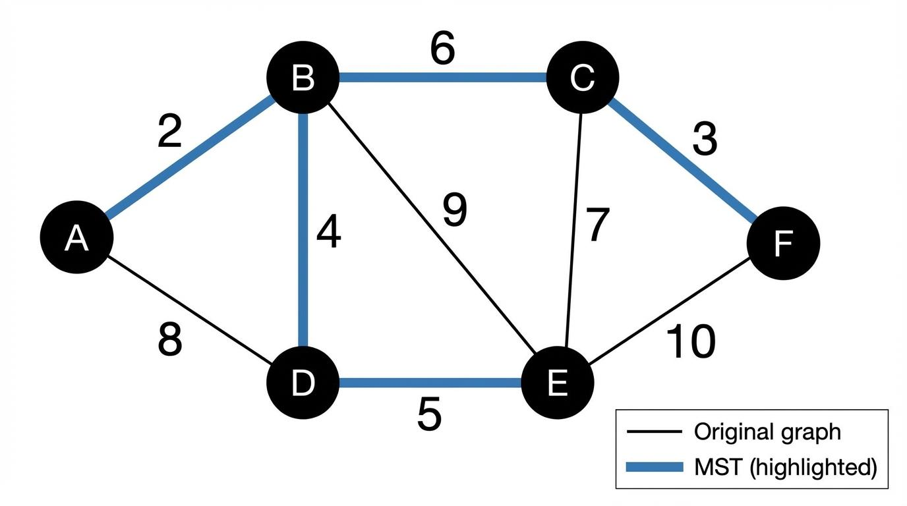
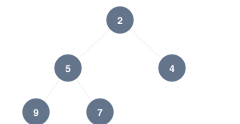
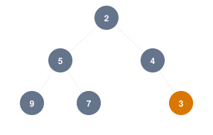
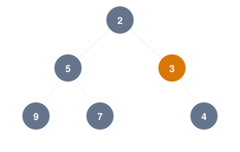
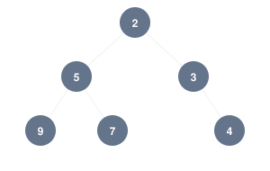
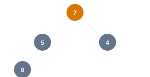
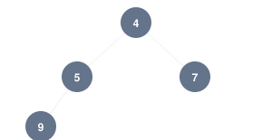
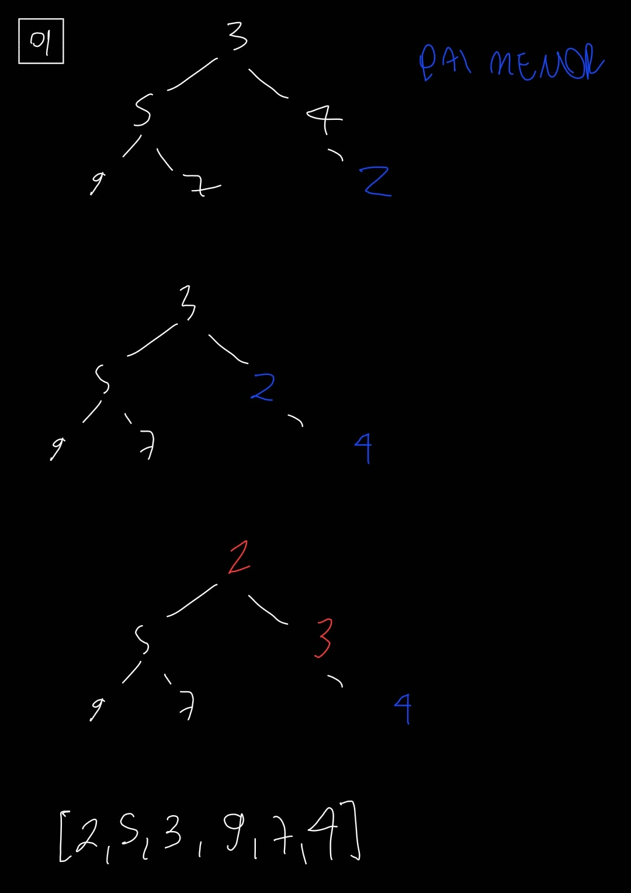
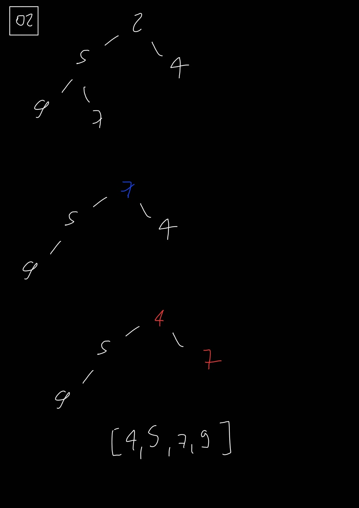

# Grafos

## 1. BFS (Breadth-First Search): busca em largura

**Analogia**
**i)** Imagine que você joga uma pedra em um lago.
**ii)** As ondas começam no ponto em que a pedra caiu e se espalham para todos os lados. Primeiro alcançam os lugares mais próximos, depois os mais distantes.

&emsp;Ela explora todos os vizinhos mais próximos antes de avançar para os mais distantes.

**Passo 1:** começar em A
&emsp;A é a origem. Marcamos A como visitado.

**Passo 2:** visitar os vizinhos de A
&emsp;Os vizinhos são B e C.

&emsp;Agora temos:
- A: já foi processado.
- B e C: foram descobertos e estão esperando para serem processados.

**Passo 3:** processar B
&emsp;Descobrimos os vizinhos de B que ainda não foram visitados: D.

**Passo 4:** processar C
&emsp;Descobrimos E.

**Passo 5:** processar D
&emsp;Encontramos F.

### Como o algoritmo consegue fazer isso?
&emsp;**Fila** (Queue)
&emsp;Quem chega primeiro é atendido primeiro.
&emsp;Quem chega depois fica atrás. **FIFO** (First In, First Out)

&emsp;Na BFS:

1. Colocamos a origem na fila.
2. Retiramos o primeiro vértice.
3. Visitamos seus vizinhos ainda não descobertos.
4. Colocamos esses vizinhos no final da fila.
5. Repetimos até a fila acabar ou encontrarmos o destino.

&emsp;Em grafos não ponderados, a BFS encontra o caminho com o menor número de arestas.

&emsp;Isso não significa que ela sempre encontre o caminho de menor tempo ou menor distância física.

&emsp;Se uma aresta representar uma viagem de 2 minutos e outra representar uma viagem de 30 minutos, a quantidade de arestas não será suficiente para determinar o caminho mais rápido. Para considerar pesos diferentes, podemos precisar do Dijkstra.

&emsp;BFS é ótima para encontrar o menor caminho em quantidade de arestas, quando todas as arestas têm o mesmo custo.

## 2. DFS (Depth-First Search): busca em profundidade

**Analogia**
**i)** Imagine que você está explorando um labirinto.
**ii)** Você entra em um corredor e decide continuar andando até não conseguir mais avançar. Quando encontra um beco sem saída, volta até o último cruzamento e tenta outro caminho.

&emsp;Ela explora uma ramificação o máximo possível antes de voltar e tentar outra.

### Como consegue fazer isso?
&emsp;**Pilha** (Stack).

&emsp;A pilha funciona como uma pilha de pratos:
- O último prato colocado é o primeiro retirado.
- O último elemento que entrou é o primeiro a sair. **LIFO** (Last In, First Out).

&emsp;Podemos utilizar uma pilha explicitamente ou a própria pilha de chamadas da linguagem de programação, quando usamos recursão.

### O que é recursão?
&emsp;É quando uma função chama a si mesma.

&emsp;Imagine uma função chamada visitar(vértice).

&emsp;Ela faz o seguinte:
1. Marca o vértice atual como visitado.
2. Percorre seus vizinhos.
3. Para cada vizinho ainda não visitado, chama visitar(vizinho).
4. Quando não há mais vizinhos novos, a função termina e retorna à chamada anterior.

&emsp;A função vai chamando a si mesma, aprofundando a exploração. Quando chega a um ponto sem saída, as chamadas terminam e o programa retorna aos pontos anteriores. Esse retorno é chamado de **backtracking**.

&emsp;Quando uma ramificação não permite avançar, o algoritmo volta ao vértice anterior e continua explorando os vizinhos que ainda não foram visitados.

&emsp;DFS, existem dois tipos de arestas que precisamos entender:
- **Aresta de árvore:** leva a um vértice que ainda não havia sido visitado.
- Aresta de retorno: conecta o vértice atual a um ancestral que ainda está ativo na exploração.

---

# Algoritmos de otimização em grafos

## 3. Dijkstra

&emsp;Encontra o caminho de menor custo, considerando todos os caminhos possíveis de maneira organizada, sem precisar testar todas as combinações.

&emsp;Ele considera tudo o que já foi percorrido/acumulado desde a origem.

>Apenas pesos não negativos

&emsp;Dijkstra utiliza três estruturas para controlar a busca.

**1. Vetor de distâncias (dist)**

&emsp;Guarda o menor custo conhecido da origem até cada vértice.

&emsp;No começo, sabemos que estamos na origem, mas ainda não conhecemos os custos dos outros caminhos.

&emsp;Por isso, inicializamos assim:

| Vértice | Distância inicial |
| :--- | :--- |
| A (origem) | 0 |
| B | ∞ |
| C | ∞ |
| D | ∞ |
| E | ∞ |
| F | ∞ |

**2. Vetor de antecessores (ant)**

&emsp;Guarda de onde viemos para chegar a cada vértice pelo melhor caminho conhecido.

&emsp;Por exemplo, se descobrirmos que a melhor maneira de chegar a C é passando por A: ant[C] = A

**3. Conjunto de vértices fechados (fechado)**

&emsp;Controla quais vértices já tiveram sua menor distância confirmada.

### Relaxamento
&emsp;Verificar se passar pelo vértice atual oferece um caminho mais barato até um vizinho do que o caminho que já conhecíamos.

### Por que o Dijkstra não aceita pesos negativos?
&emsp;Imagine que o algoritmo já encontrou o menor caminho até um vértice e decidiu fechá-lo.
&emsp;Mas, mais adiante, aparece uma aresta com peso negativo que reduz o custo de um caminho que passa por outro vértice.
&emsp;Isso poderia significar que a distância que já considerávamos definitiva estava errada.

### Implementação com heap binário
&emsp;Agora imagine que temos milhares de vértices.
&emsp;Em vez de procurar o menor valor percorrendo todos os vértices, podemos utilizar uma estrutura que mantém o menor elemento organizado para ser retirado primeiro.

#### Resumo:
&emsp;**Escolher o próximo vértice:** o algoritmo seleciona aquele que tem a menor distância acumulada entre os vértices ainda não fechados.
&emsp;**Relaxar as arestas:** depois de selecionar esse vértice, o algoritmo verifica se passar por ele permite melhorar as distâncias dos vizinhos.

&emsp;Essas duas operações trabalham juntas.

## 4. Prim 

&emsp;Procura a maneira mais barata de conectar todos os vértices da rede.
ncontra uma forma de conectar todos os vértices de um grafo com o menor custo total possível.

### 4.1 Árvore geradora mínima (Minimum Spanning Tree, ou MST)

&emsp;Precisa atender a três condições:

1. Conectar todos os vértices: nenhum ponto pode ficar isolado.
2. Não formar ciclos: não pode haver um caminho fechado desnecessário.
3. Ter o menor custo total possível: a soma dos pesos das arestas deve ser mínima.

&emsp;O algoritmo de Prim constrói a árvore geradora mínima aos poucos, começando por um **vértice qualquer.**

&emsp;A cada etapa, ele escolhe a aresta de menor peso que conecta um vértice já incluído na árvore a um vértice que ainda está fora dela.

&emsp;Prim não escolhe simplesmente a menor aresta do grafo inteiro. Ele escolhe a menor aresta que permite expandir a árvore atual sem criar um ciclo.

>Em um grafo conexo com \(V\) vértices, seleciona \(V-1\) arestas.

>Grafo convexo, não direcionado e ponderado.

## Comparação

| Dijkstra | Prim |
| :--- | :--- |
| Menor custo de um caminho a partir de uma origem | Menor custo para conectar todos os vértices |
| Soma dos pesos ao longo de cada caminho | Soma dos pesos das arestas escolhidas para conectar o grafo |
| Mantém distâncias acumuladas a partir da origem | Expande uma árvore de vértices conectados |
| Resultado: caminhos mínimos | Resultado: árvore geradora mínima |

---

# Fila de prioridade e heap binária

&emsp;Estruturas de dados que ajudam a executar algoritmos como Dijkstra e Prim com mais eficiência.

&emsp;O problema é ficar procurando manualmente o menor valor em uma lista com muitos vértices pode ser custoso.

## 1. Fila de prioridade 

&emsp;Estrutura de dados em que cada elemento possui uma prioridade, e a remoção acontece de acordo com essa prioridade. Ela não segue necessariamente a ordem de chegada.

&emsp;Sai primeiro o elemento que possui a maior prioridade (depende da regra escolhida).

## 2. Heap binária

&emsp;Estrutura de dados que permite implementar uma fila de prioridade de maneira eficiente.

&emsp;Árvore binária que respeita algumas regras específicas.

### 2.1 Min-heap

&emsp;O menor valor fica sempre na raiz, tem maior prioridade, sai primeiro.

&emsp;Regras:
1. Cada nó pode ter, no máximo, dois filhos.
2. O valor de cada pai deve ser menor ou igual aos valores de seus filhos.
3. A árvore deve ser completa: os níveis são preenchidos da esquerda para a direita, sem deixar espaços no meio.

### Heap binária

#### Inserir um elemento

&emsp;Queremos inserir o número 3.

**Passo 1:** inserir na próxima posição disponível.

&emsp;Uma heap precisa continuar sendo uma árvore completa. Por isso, não podemos simplesmente colocar o 3 em qualquer lugar.

&emsp;A próxima posição livre é à direita do nó 4, no último nível.

  Após inserir o 3 
   

**Passo 2:** comparar o 3 com seu pai.

&emsp;O pai do 3 é o 4.

&emsp;Como estamos em uma min-heap, o pai precisa ser menor ou igual ao filho.

&emsp;Mas temos 4 como pai e 3 como filho. A regra foi violada, porque 4 é maior que 3.

&emsp;Então, trocamos os dois de posição.

  Após a primeira troca 
   

>Esse movimento é chamado de subir na heap (sift up ou heapify up).

**Passo 3:** comparar o 3 novamente com seu novo pai.

&emsp;Agora o 3 está na posição em que antes estava o 4. Seu pai é o 2.

&emsp;Como 2 é menor que 3, a regra da min-heap está respeitada. Portanto, paramos.

  Resultado final 
   

#### Remover o menor elemento

Queremos remover o menor elemento, que é o 2.

**Passo 1:** retirar a raiz.

&emsp;O 2 é removido. Mas não podemos deixar a raiz vazia, porque a árvore precisa continuar completa.

&emsp;Então, pegamos o último elemento do vetor, que é o 7, e colocamos na raiz.

  Após retirar o 2 e colocar o 7 na raiz 
   

>Esse movimento é chamado de descer na heap (sift down ou heapify down).

**Passo 2:** comparar o 7 com seus filhos.

&emsp;O 7 é maior que os dois. Portanto, precisamos trocá-lo com o menor dos filhos (4).

  Após trocar 7 e 4 
   

**Passo 3:** verificar se precisamos continuar descendo.

&emsp;O 7 agora não tem filhos. Portanto, não há mais nenhuma regra violada.

#### Questão 1
Temos uma min-heap [3, 5, 4, 9, 7]. Inserimos o número 2. Qual será o vetor final?

#### Questão 2
Temos uma min-heap [2, 5, 4, 9, 7]. Removemos o menor elemento. Qual será o vetor final?

---

# A*

&emsp;Algoritmo de busca de caminhos. Seu objetivo é encontrar a rota de menor custo entre um ponto de partida e um destino.

&emsp;Imagine que você está em uma estação da CPTM e quer chegar a outra. Existem vários caminhos possíveis, mas você não quer simplesmente explorar todos eles. Quer encontrar um caminho eficiente até o destino.

&emsp;É justamente isso que o A* tenta fazer: além de considerar o custo que você já percorreu, **ele estima o quanto ainda falta para chegar ao destino.**

**Dijkstra:** considera o custo acumulado desde a origem.

<b>A*:</b> considera o custo acumulado desde a origem e uma estimativa do custo restante até o destino.

## 1. Função \(f(n)\)

\[\boxed{f(n)=g(n)+h(n)}\]

&emsp;Cada parte representa uma informação:

- \(g(n)\): custo real acumulado da origem até o nó atual.
- \(h(n)\): estimativa do custo do nó atual até o destino.
- \(f(n)\): custo estimado total do caminho, passando pelo nó atual.
Vamos entender cada uma.

### 1.1. Custo acumulado: \(g(n)\)

&emsp;É o custo que você já percorreu para chegar até determinado ponto.

&emsp;Imagine que você saiu da estação A e chegou à estação C, passando por B:

- A → B: custo 3.
- B → C: custo 4.

Então:
\[g(C)=3+4=7\]

&emsp;Você já gastou 7 unidades de custo para chegar a C.

### 1.2. Heurística: \(h(n)\)

&emsp;É uma estimativa de quanto ainda falta para chegar ao destino.

&emsp;Imagine que seu destino é D. Você está na estação C e estima que ainda faltam 5 unidades de custo para chegar até lá.

Então: 
\[h(C)=5\]

>Atenção: esse valor não precisa ser o custo real do caminho. É uma estimativa utilizada para orientar a busca.

>A heurística do ponto final é zero porque, quando já estamos no destino, não falta nada para chegar até ele.

>Heurística admissível nunca superestima o custo real mínimo restante.

### 1.3. Custo estimado total: \(f(n)\)

&emsp;Agora basta somar os dois valores:

\[f(C)=g(C)+h(C)\]
\[f(C)=7+5=12\]

&emsp;Isso significa que, passando por C, o algoritmo estima que o custo total da rota será 12.